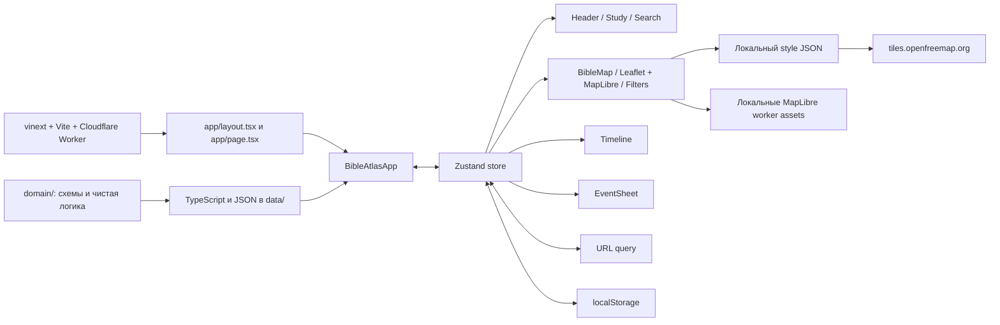

# Технический паспорт проекта «Интерактивная Библейская карта»

> Главный документ для сопровождения, переноса и восстановления проекта.  
> Актуализирован: **25 августа 2026 года**.
> Зафиксированное состояние: версия `0.1.0`, актуальное состояние ветки `main`, 169 событий, 125 мест, 25 персонажей и 20 сюжетных линий.

## 1. Назначение документа

Этот файл является главным техническим описанием проекта. Он фиксирует:

- назначение и фактические возможности приложения;
- архитектуру, потоки данных и состояние интерфейса;
- структуру каталогов и роль каждого исходного файла;
- модели библейских данных и редакционные ограничения;
- зависимости, команды, переменные окружения и внешние сервисы;
- порядок локального запуска, сборки, тестирования, публикации и полного восстановления;
- генерируемые, локальные и необязательные файлы;
- известные технические долги и результаты последней проверки.

Правило обязательной синхронизации закреплено в корневом `AGENTS.md`: любое изменение исходников, данных, конфигурации, зависимостей, тестов, структуры или поведения проекта должно сопровождаться обновлением этого документа в той же задаче.

## 2. Краткое описание продукта

«Библейская карта» — русскоязычное одностраничное веб-приложение, связывающее события Священного Писания с:

- географическими местами и современными координатами;
- временной шкалой без фиктивного нулевого года;
- персонажами;
- книгами Писания;
- сюжетными линиями и последовательностями маршрутов;
- точными ссылками и встроенным текстом Синодального перевода 1876 года;
- общим для православных, католиков и протестантов 66-книжным корпусом;
- отдельными редакционными слоями истории и географии.

Приложение работает преимущественно на клиенте. Для основного сценария не требуются аккаунты, CMS, API приложения или база данных. Библейские данные включаются в клиентскую сборку из локальных TypeScript- и JSON-файлов.

### Фактические пользовательские возможности

- интерактивная карта Leaflet с подробной приглушённой векторной подложкой MapLibre + OpenFreeMap/OpenMapTiles и приоритетом подписей русский → английский/латиница → местный;
- группировка событий по основной географической точке;
- маркеры Ветхого и Нового Заветов, интерактивные подписи мест;
- пунктирные маршруты книги, персонажа или выбранной сюжетной линии;
- отдельные отключаемые слои современных русел Тигра и Евфрата и 11 схематичных земель/областей, прямо названных в Писании; для областей можно выбрать одну, несколько или все, а значок `i` у названия открывает редакционное объяснение и источники контура;
- компактный выпадающий фильтр непосредственно на карте рядом с легендой: Завет, маршруты, реки и области переключаются без ухода с карты и применяются сразу;
- масштабирование карты до уровня `18`, небольшая метрическая шкала, возврат к домашней области и обработка ошибки тайлов;
- временная шкала с пятью уровнями масштаба, двусторонним диапазоном, перетаскиванием всей выбранной полосы и быстрым выбором эпох на мобильных устройствах; при выбранной книге mobile-лента заменяется навигатором текущего события: стрелки меняют активную точку без открытия карточки, а явно подписанная центральная кнопка открывает подробности;
- режимы сюжета, персонажа, места, книги и «Все точки Писания»;
- быстрый раздел «Люди Писания» для 10 персонажей, включая Исаака, Иакова (Израиля), Иосифа (сына Израиля) и апостола Петра;
- полнотекстовый локальный поиск по событиям, людям, местам, сюжетам и книгам;
- карточка события с вкладками «Писание», «История» и «География»; на телефоне она открывается примерно на половину экрана, имеет явное управление «Развернуть», раскрывается до `77dvh`, закрывается свайпом вниз, а выбранные маркер и подпись места остаются на карте; сохранённые поля толкований, Предания и подробные конфессиональные пояснения в пользовательский интерфейс не выводятся, но явно выбранное событие без публичной координаты получает пунктирный условный ориентир с подписью статуса локализации;
- встроенный текст всех 221 используемых отрывков Синодального перевода;
- отдельная картографическая последовательность раннего служения по Лк. 3:21–7:17: Иордан, искушение с прямо названным Иерусалимом, Галилея, Назарет, Капернаум, озеро Геннисаретское, условный маркер неизвестного места проповеди после избрания двенадцати, исцеление слуги сотника в Капернауме и Наин;
- расширенные географические последовательности всех 22 представленных книг: в частности, стоянки Исхода, походы Иисуса Навина, места Судей и пророков, промежуточные переходы четырёх Евангелий и ранних глав Деяний;
- закладки и продолжение с последнего открытого события;
- автоматическое проигрывание сюжетной последовательности со скоростью `0.5×`, `1×` или `2×`; на телефоне карта плавно перелетает между точками, а событие показывается компактной карточкой;
- сохранение выбранного режима в URL;
- адаптивный интерфейс для настольных и мобильных экранов, включая portrait/landscape, вырезы экрана и нижний Home Indicator в Safari/iOS;
- трехшаговый onboarding при первом открытии;
- web app manifest для установки как standalone-приложения.

## 3. Архитектура

### 3.1. Общая схема



### 3.2. Выполнение приложения

1. `worker/index.ts` передаёт обычные запросы обработчику vinext, `/_vinext/image` — обработчику оптимизации изображений Cloudflare, а локальный style JSON и два MapLibre-модуля — Sites asset binding `ASSETS`.
2. `app/layout.tsx` задаёт русскую локаль, метаданные, шрифты Geist/Lora, manifest, Leaflet/MapLibre CSS и глобальные стили.
3. `app/page.tsx` монтирует клиентский корневой компонент `BibleAtlasApp`.
4. `BibleAtlasApp` читает URL и `localStorage`, инициализирует Zustand, отделяет события выбранной коллекции от событий внутри активного временного диапазона и раскладывает интерфейс на панель изучения, карту, шкалу и глобальные панели. После клиентской инициализации корень получает `data-app-ready="true"` для E2E-диагностики.
5. `BibleMap` динамически импортирует Leaflet, MapLibre GL JS и официальный Leaflet-адаптер только в браузере. Leaflet сохраняет управление картой и библейскими overlay, а MapLibre рисует неинтерактивную нижнюю векторную подложку; `FiltersPanel` монтируется рядом с легендой.
6. `Timeline`, `StudyPanel`, `SearchOverlay`, `FiltersPanel` и `EventSheet` читают/изменяют единое состояние Zustand. Локальная степень раскрытия `EventSheet` намеренно не сохраняется в store и сбрасывается для каждого нового открытия; `Timeline` использует `activeBookId`/`activeEventId`, чтобы на mobile заменить эпохи навигатором событий книги.
7. Изменения ключевых выборов записываются обратно в query string без перезагрузки страницы.

### 3.3. Приоритет фильтрации событий

В `BibleAtlasApp` события отбираются в следующем порядке:

1. фильтр Завета (`ALL`, `OT`, `NT`);
2. выбранная сюжетная линия;
3. иначе выбранный персонаж;
4. иначе выбранное место;
5. иначе выбранная книга;
6. если последним выбран временной диапазон, `timeRange` ограничивает события Завета пересечением с выбранным интервалом, а прежняя коллекция очищается;
7. если последней выбрана коллекция или режим «Все точки», временная фильтрация отключается и коллекция показывается целиком;
8. в начальном режиме без коллекции показывается не более 18 событий важности `5`.

Выбор сюжета, персонажа, места, книги или временного диапазона взаимоисключающий: действует последний выбор. `setTimeRange` очищает коллекционный режим, а выбор любой коллекции снимает `timelineFocused`. Фильтр Завета остаётся отдельным глобальным ограничением. Выбор конкретного события открывает карточку, но не меняет режим верхнего уровня; закрытие карточки сохраняет выбранное событие и только меняет видимость панели. Открытие `StudyPanel` закрывает мобильный фильтр, а его trigger скрывается CSS-правилом на всё время выхода панели.

Шкала разделяет отображаемое окно `timeWindow` и выбранный фильтрующий интервал `timeRange`. Левый и правый края интервала регулируются независимо мышью, касанием или клавиатурой; после сужения всю полосу можно перетащить внутри отображаемого окна. Кнопки сдвига перемещают окно и интервал вместе. При выборе книги, сюжетной линии, персонажа, места или режима всех точек шкала автоматически устанавливает границы по первой начальной и последней конечной датам коллекции. Для коллекции из одной календарной даты добавляется по одному соседнему библейскому году; коллекции только с `relative`/`unknown` не получают выдуманных календарных границ.

### 3.4. Карта

Фактический картографический стек — **Leaflet 1.9.4 + MapLibre GL JS 6.5 + официальный адаптер MapLibre GL Leaflet + OpenFreeMap/OpenMapTiles**. Leaflet остаётся владельцем viewport, controls и всех библейских слоёв; MapLibre используется только как неинтерактивная нижняя pane подложки.

- URL стиля по умолчанию: локальный `/map/openfreemap-ru.json`; его можно заменить через `NEXT_PUBLIC_MAP_STYLE_URL`.
- Отслеживаемый style JSON воспроизводимо создаётся из закреплённого OpenFreeMap Liberty commit `72e1480dfc92858d334647037988bd2591fdb021`; генератор сверяет upstream SHA-256 `943938d11203cf6d4011ef161a19bedc214737a4b96a10c19d13fa000bba16f4`, уменьшает насыщенность на `-0.35` и смешивает цвета с `#fffdf7` на `0.18`. Пакет `@versatiles/style` используется только как build-time утилита преобразования цветов и не задаёт runtime-источник.
- Текстовые выражения 20 слоёв подписей проверяемо используют `name:ru`, затем совместимое `name_ru`, английское/латинское имя (`name_en`, `name:en`, `name:latin`, `name_int`) и только затем местное `name`. Публичные данные OpenFreeMap были проверены на фактическое наличие русских значений для Каира, Дамаска, Иерусалима и Анкары; прежний Shortbread-источник VersaTiles для региона не содержал `name_ru`, поэтому декларативная настройка русского языка не давала русскую карту.
- TileJSON/векторные данные, glyphs, sprites и низкомасштабный рельеф стандартного стиля загружаются с `https://tiles.openfreemap.org`; отдельного растрового OSM fallback нет.
- MapLibre исполняется через `/assets/maplibre-gl-worker.mjs`, который импортирует `/assets/maplibre-gl-shared.mjs`. Обе копии создаются из установленного `maplibre-gl` при dev/build и в Git не отслеживаются.
- Домашняя область: юго-запад `[24, 10]`, северо-восток `[43.5, 50]`.
- Ограничение перемещения: `[12, -18]` — `[55, 72]`.
- Минимальный масштаб: `3`; максимальный масштаб интерфейса: `18`.
- Автоматические подписи мест появляются с масштаба `11` и на desktop, и при ширине до `767px`; активная подпись видна всегда, в том числе после закрытия карточки свайпом или крестиком. Mobile-tooltip сокращён до названия и числового badge, длинные названия обрезаются, а пересекающиеся подписи автоматически прореживаются после zoom/move на всех размерах экрана.
- События в одном основном месте объединяются в один круглый маркер. Обычный обзор коллекции использует только UI-проекцию географии и не добавляет скрытые координаты.
- Цвет маркера определяется Заветом; активный маркер имеет увеличенный радиус и белую обводку. Если у явно выбранного события или места UI-проекция скрыла существующую исходную координату, `getSelectedEventLocation` возвращает её только для временного активного ориентира: маркер получает пунктирную обводку, уменьшенную непрозрачность, `selection-fallback`, диагностические `data-location-display`/`data-localization-type`, а tooltip сообщает статус и слова «условный ориентир».
- Маршрут строится по основным местам последовательных событий, пропускает отсутствующие координаты и подряд повторяющиеся точки.
- Линия маршрута — визуальное соединение последовательности мест, а не утверждение о точной древней дороге.
- Ручной выбор события перемещает центр карты через `panTo`, не изменяя масштаб; для скрытой UI-координаты используется тот же условный ориентир, поэтому Преображение и аналогичные события теперь получают видимую активную точку и перемещение карты. Активное событие добавляется в набор маркеров даже тогда, когда оно не входит в текущую видимую коллекцию. Первичный `fitBounds` режима «Все точки Писания» вынесен в отдельный effect и не повторяется при смене активного события, поэтому клик по точке сохраняет zoom и в этом режиме. Во время мобильного проигрывания используется `flyTo` длительностью `1.15 s`, который даёт плавный перелёт с изменением масштаба между последовательными точками.
- В левом нижнем углу добавлена компактная метрическая шкала Leaflet с максимальной шириной `90px`; она расположена над строкой атрибуции.
- Для режима всех точек используется однократный initial `fitBounds`, а для маршрута — отдельный `fitBounds` при изменении маршрута; в обоих случаях максимальный масштаб подгонки ограничен.
- Подложка считается готовой после загрузки стиля и первых данных источника. Фатальная ошибка стиля, четыре ошибки источника до готовности или тайм-аут `15 s` включают панель повторной загрузки; кнопка «Повторить» пересоздаёт только MapLibre-подложку, не сбрасывая Leaflet, overlay, store, URL или zoom. При отсутствии WebGL/сети остаются фон карты и библейские слои.
- Диагностический контракт: `data-map-engine="leaflet-maplibre-openfreemap"`, `data-basemap-language="ru"`, прежние `data-basemap-status` и `data-map-ready`.
- Тигр и Евфрат берутся из `data/biblical-rivers.json`; геометрия основана на HydroRIVERS и описывает современные русла.
- Отключаемый слой земель и областей рисует выбранные пользователем пунктирные полигоны из набора 11 территорий: Египет, землю Ханаанскую, Месопотамию, Галилею, Самарию, Иудею, Идумею, Десятиградие, страну Гадаринскую, Заиорданье и Моав. Страна Гадаринская показана только как спорная учебная область восточного и юго-восточного берега моря Галилейского: Мк. 5:1–20 и Лк. 8:26–39 в локальном Синодальном тексте используют это название, а Мф. 8:28–34 называет страну Гергесинскую. Контуры уточнены по природным рубежам и историческим справочным картам; заливка `0.18`, непрозрачность обводки `0.94`, толщина `2.2 px`. В фильтрах доступны действия «Все» и «Очистить» и отдельный checkbox каждой территории.
- Кнопка «Фильтры» находится в верхней панели самой карты. На desktop она сохраняет подпись, соседнюю легенду и прежний ограниченный высотой dropdown. На mobile легенда скрыта, остаётся единственная квадратная иконка с touch-target `44×44px`, а панель через React portal монтируется непосредственно в `document.body`, вне обрезающего контейнера карты. Изменения применяются немедленно, меню закрывается кнопкой «Готово», крестиком, `Escape` или нажатием вне него.
- Каждый полигон имеет ссылку на место Писания и всплывающее предупреждение: контур является учебной схемой, поскольку Писание не задаёт координат границ, а исторические пределы менялись.
- При масштабе ниже `7` подписываются крупные области Египта, Ханаана и Месопотамии; с масштаба `7` — меньшие области Палестины и Заиорданья. Рядом с каждой подписью находится кликабельный значок `i`: он открывает основание редакционного контура, прямые ссылки, назначение и лицензию каждого источника. Подписи вынесены в отдельный Leaflet pane с `z-index: 625`, поэтому маркеры событий не перехватывают клик по `i`; текст подписи сам не блокирует клики по карте.

### 3.5. Состояние и сохранение

Единое состояние находится в `store/useBibleStore.ts`.

| Группа | Поля |
| --- | --- |
| Основной выбор | `activeEventId`, `activeStorylineId`, `activeCharacterId`, `activeLocationId`, `activeBookId`, `allPointsEnabled` |
| Временная шкала | `timeRange`, `timeWindow`, `timelineZoom`, `timelineFocused` |
| Карта | `testamentFilter`, `historicalRegionsEnabled`, `selectedHistoricalRegionIds`, `biblicalRiversEnabled`, `routesEnabled` |
| Панели | `searchOpen`, `studyOpen`, `filtersOpen`, `eventSheetOpen`, `sheetTab` |
| Поиск | `searchQuery`, `searchMode` |
| Пользовательские данные | `bookmarkIds`, `storyPlaying`, `storySpeed` |

URL-параметры:

| Параметр | Значение |
| --- | --- |
| `event` | ID выбранного события; после скрытия карточки остаётся в URL вместе с выделением точки |
| `story` | ID сюжетной линии |
| `person` | ID персонажа |
| `place` | ID места |
| `book` | ID книги |
| `view=all` | режим всех точек |
| `testament=OT` / `NT` | фильтр Завета; `ALL` в URL не записывается |

Ключи `localStorage`:

| Ключ | Назначение |
| --- | --- |
| `bible-map-onboarding` | признак завершённого onboarding |
| `bible-map-bookmarks` | JSON-массив ID событий-закладок |
| `bible-map-last-event` | последнее открытое событие |

При старте приложение удаляет старые регистрации Service Worker и кэши с префиксом `biblical-map-`. Текущая версия имеет manifest, но **не имеет offline-кэша или активного Service Worker**.

`lib/analytics.ts` содержит только типизированную точку расширения; события аналитики сейчас никуда не отправляются.

`sheetTab` допускает только `scripture`, `history` и `geography`. При выборе нового события карточка всегда возвращается на вкладку Писания; состояния и пользовательского маршрута к сохранённым заметкам Предания нет. `activeEventId` отвечает за выбранное событие, активный маркер и постоянную подпись, а `eventSheetOpen` — только за видимость карточки. `closeEventSheet` не сбрасывает выбор; повторное нажатие того же маркера или tooltip снова открывает карточку. `sheetExpanded` — локальное состояние `EventSheet`: оно не сериализуется и при новом событии/открытии возвращается в компактное положение.

### 3.6. Адаптивная геометрия и Safari

Высота основного интерфейса задаётся CSS-переменной `--app-height`: `100vh` служит резервом, а при поддержке dynamic viewport используется `100dvh`. У приложения нет жёсткой минимальной высоты, поэтому оно не обрезается в мобильной landscape-ориентации.

- `app/layout.tsx` включает `viewportFit: "cover"`.
- Header, workspace, timeline, панели, модальные слои и элементы карты учитывают `env(safe-area-inset-*)`.
- Высота мобильной ленты эпох увеличивается на нижний safe-area, поэтому Home Indicator не отнимает место у кнопок.
- При ширине до `767px` поиск и About становятся полноэкранными. У фильтра остаётся только иконка `44×44px`; панель рендерится portal-слоем поверх workspace, получает фиксированные отступы от header, краёв visual viewport и safe-area и больше не наследует `overflow: hidden` карты. Длинное содержимое имеет явные `overflow-y: scroll`, `touch-action: pan-y` и инерцию WebKit; sticky-кнопка «Готово» остаётся в пределах панели. При открытом левом `StudyPanel` trigger фильтра получает `visibility: hidden`, `opacity: 0` и не перехватывает касания.
- На высоте до `500px` обычная карточка события занимает весь экран; на телефонах лента эпох сохраняется, а для промежуточной ширины `768–900px` применяется прежняя компактная геометрия. Исключение — режим проигрывания: его карточка остаётся компактной при любой мобильной высоте.
- Поле мобильного поиска имеет размер шрифта `16px`, чтобы Safari не увеличивал страницу при фокусе.
- Полноэкранный mobile-поиск имеет собственный слой `z-index: 1300` выше map toolbar, поэтому иконка фильтра не перекрывает горизонтальный список режимов поиска.
- Для полупрозрачных слоёв одновременно заданы `backdrop-filter` и `-webkit-backdrop-filter`.
- Основные мобильные управляющие элементы имеют touch-target не меньше `44px`; карта показывает только иконку фильтра, а desktop-легенда не изменена.
- Только при ширине до `767px` временной блок сокращён до высоты `64px` плюс нижний safe-area: заголовок диапазона, кнопки сдвига/масштаба, трек, маркеры и подписи дат скрыты. Без книги показывается однострочная CSS Grid-лента эпох с несжимаемыми колонками и нативной горизонтальной прокруткой WebKit (`overflow-x: scroll`, `touch-action: pan-x`, `-webkit-overflow-scrolling: touch`). При выбранной книге эпохи скрываются и на их месте появляется трёхколоночный навигатор: крайние стрелки вызывают `focusEvent`, меняют активное событие/точку, выполняют map-pan и оставляют `eventSheetOpen=false`; центральная кнопка с подписью «Событие книги · открыть подробности» вызывает `selectEvent` и открывает карточку. Крайние стрелки блокируются. До выбора конкретного события текущим считается первое событие книги. Desktop timeline сохраняет полный функционал.
- При мобильном проигрывании `StudyPanel` закрывается после нажатия Play, а полная карточка заменяется панелью высотой не более `142px` над лентой эпох: видны название, дата, место, двухстрочный пересказ, пауза и переход к полной карточке. Карта остаётся видимой.
- На portrait-экране обычная мобильная карточка стартует с высотой `min(50dvh + safe-area, 470px)` и по нажатию «Развернуть» либо свайпу вверх от `48px` переходит к `min(77dvh + safe-area, 680px)`. Верхнее управление всегда показывает текущую возможность («Развернуть»/«Свернуть») и стрелку. Свайп вниз остаётся жестом закрытия: смещение отображается синхронно пальцу, порог `72px` или быстрый жест от `24px` запускает закрытие за `190ms`, а короткое движение возвращает карточку на место. На высоте до `500px` сохраняется полноэкранная landscape-геометрия без текстовой подсказки; desktop не затронут.
- В обычной мобильной карточке шапка уплотнена: handle с подсказкой занимает `32px`, badge — `18px`, заголовок — `19px`; дата и место остаются в одной строке, длинная дата сокращается через ellipsis, а кнопки закладки и закрытия сохраняют touch-target `44×44px`.

## 4. Данные и предметная модель

### 4.1. Текущий объём

| Набор | Количество / размер |
| --- | --- |
| События | 169: 102 Ветхого Завета, 67 Нового Завета |
| События с географией | 164; без географии — 5 |
| Места | 125 |
| Традиционно локализованные записи, скрытые проекцией UI | 15; в интерфейсе имеют `unknown` без координат и конфессиональных пояснений |
| Персонажи | 25 |
| Персонажи в быстром разделе «Люди Писания» | 10 |
| Сюжетные линии | 20 |
| Книги, фактически связанные с событиями | 22 |
| Допустимый корпус приложения | 66 книг, общих для православных, католиков и протестантов |
| Структурированные ссылки на Писание | 221 |
| Исходный Синодальный файл | 78 разделов-книг, около 6.16 МБ; служит только источником генерации |
| Выборка используемых отрывков | 221 ключ, около 1.13 МиБ |
| Реки | 2 GeoJSON LineString: Евфрат и Тигр |
| Земли и области | 11 схематичных полигонов со ссылками на Писание |

Фактически используемые книги: Бытие, Исход, Числа, Второзаконие, Иисус Навин, Судьи, 1–4 Царств, Иона, Исаия, Иеремия, Даниил, 1 Ездры, Есфирь, Неемия, четыре Евангелия и Деяния.

Пять событий намеренно не имеют картографической точки: сотворение, Каин и Авель, потоп, рождение Исаака и призвание Иеремии. Для двух последних точка удалена в текущем аудите: Быт. 21:1–8 не называет место рождения Исаака, а Иер. 1:1–19 называет Анафоф местом служения священников, но не местом самого призвания.

Схемы поддерживают больше вариантов, чем текущий контент. Например, хронология допускает `exact`, `range` и `unknown`, но текущие 169 событий используют `relative` (6 событий) или `approximate` (163 события). Все текущие события имеют `evidenceType: scripture_explicit`.

### 4.2. `BibleEvent`

| Поле | Смысл |
| --- | --- |
| `id`, `slug` | стабильный уникальный идентификатор; сейчас совпадают |
| `titleRu`, `shortTitleRu` | русское название |
| `scriptureSummary` | нейтральный пересказ указанного текста |
| `historicalNote` | отдельно маркированная историческая справка |
| `traditionNote` | сохранённое, но неактивное редакционное поле; текущий UI его не выводит |
| `evidenceType` | явное Писание, вывод, Предание или реконструкция |
| `testament` | `OT` или `NT` |
| `category`, `tags` | классификация и необязательные теги |
| `importance` | целое число 1–5; влияет на начальный экран |
| `chronology` | тип, годы, русская подпись, уверенность и пояснение |
| `locations` | связанные места, их роль и порядок |
| `characters` | ID персонажей |
| `scriptureReferences` | одна или несколько структурированных ссылок |
| `storylineIds` | связанные сюжетные линии |

События редактируются как компактные `EventSeed` в `data/events.ts`. Функция `makeEvent`:

- превращает основной и параллельные отрывки в `ScriptureReference`;
- назначает умолчания важности, доказательности и хронологии;
- выбирает ровно одно основное место через `mainLocation`, аудированный словарь или последнее место;
- маркирует остальные точки как начало, конец или промежуточные точки;
- формирует сюжетные связи и категории.

### 4.3. `ScriptureReference`

Хранит Завет, ID и русское имя книги, начальную/конечную главу и стих, а также отображаемую строку (`displayRu`). Парсер `data/events.ts` понимает однословные и нумерованные сокращения Ветхого и Нового Заветов (`Быт. 1:1–2:25`, `4 Цар. 18:13–19:37`, `Мф. 28:1–10`) и правильно связывает параллельные места с соответствующей книгой. Несколько раздельных диапазонов одного события задаются отдельными `scriptureReferences`, а не строкой с точкой с запятой.

Допустимые OSIS-коды перечислены в `data/common-canon.ts`. Сборщик отклоняет ссылку за пределами 66 книг, общих для православных, католиков и протестантов, и отдельно проверяет наличие всех этих книг в исходном Синодальном файле.

### 4.4. `BibleLocation`

Содержит древнее и современное имя, альтернативные имена, координаты, современную страну, важность и статус локализации:

- `identified` — достаточно устойчивое отождествление;
- `probable` — вероятная локализация;
- `traditional` — церковная или историческая традиция;
- `disputed` — конкурирующие гипотезы;
- `unknown` — современная координата не установлена.

Неочевидное или спорное место должно иметь `localizationNoteRu`. Эдем намеренно не имеет координат; ряд неизвестных мест может быть представлен только как широкая область с явным пояснением.

Исходные `locations` и `locationById` сохраняют редакционные сведения для внутреннего аудита. Обычные коллекции, маршруты, карточка и поиск используют отдельные `interfaceLocations` и `interfaceLocationById`: все записи со статусом `traditional`, а также записи, чьё пояснение прямо опирается на традиционное, церковное или православное отождествление, переводятся в `unknown`; их координаты, современное имя, страна и исходное пояснение не передаются этим постоянным представлениям. Сейчас так обрабатываются 15 записей, включая Мориа, Синай, Иордан в области Крещения, Кану, гору Преображения, Гефсиманию, Голгофу и Гроб Господень. Библейское название остаётся доступным в карточке и поиске. Для явного выбора события или места карта может временно взять существующую координату из `locationById`, но рисует её только как пунктирный условный ориентир с исходным статусом локализации; в обзор коллекции и маршрут такая точка не добавляется.

### 4.5. `BibleCharacter` и `Storyline`

Персонаж содержит ID, slug, имя, краткое описание и Завет. Сюжет содержит название, описание, Завет, вычисленный порядок событий, важность, цвет и уверенность маршрута:

- `scriptural_sequence` — последовательность мест явно следует из текста;
- `approximate` — порядок известен, точная линия пути нет;
- `disputed` — маршрут или локализации существенно спорны.

`eventIds` сюжетной линии вычисляются фильтрацией массива событий, поэтому порядок строк в `data/events.ts` является одновременно порядком повествования.

В `StudyPanel` показана курируемая выборка из 10 уже существующих персонажей: Авраам, Исаак, Иаков (Израиль), Иосиф (сын Израиля), Моисей, Давид, Пресвятая Богородица, Господь Иисус Христос, апостол Пётр и апостол Павел. Исаак, Иаков, Иосиф и Пётр связаны с существующими событиями через `BibleEvent.characters`; отдельные дубли персонажей или событий не создаются.

### 4.6. Синодальный текст

- `data/common-canon.ts` — исполняемый whitelist из 66 OSIS-кодов и русская подпись общего корпуса.
- `data/synodal-bible.json` — исходный локальный файл из 78 разделов-книг; не является каноном приложения и не попадает целиком в клиентский интерфейс.
- `data/synodal-passages.json` — компактная выборка только используемой 221 ссылки из 22 представленных книг общего корпуса; именно она попадает в интерфейс.
- `data/synodal.ts` — lookup по точной строке `displayRu`.
- Источник, записанный в метаданных: `https://ebible.org/find/details.php?id=russyn`.
- Перевод: Синодальный, редакция 1876 года, Public Domain.

После изменения ссылок событий необходимо выполнить `npm run bible:passages`, затем `npm test` и `npm run build`. Сгенерированные метаданные фиксируют `canon: shared-66`, `books: 66`, `sourceBooks: 78` и `representedBooks: 22`.

Полная повторная выгрузка корпуса выполняется `scripts/extract-synodal.py`, но сейчас скрипт содержит непереносимый абсолютный путь `C:\Users\MI\russyn1876-source`. Перед повторной генерацией на другой машине его нужно заменить на фактический каталог SWORD-модуля либо параметризовать. Для обычного переноса проекта регенерация не требуется: оба JSON-файла входят в Git.

### 4.7. Земли и области Писания

`data/biblical-regions.ts` содержит 11 редакционных полигонов. Для каждого обязательны уникальный ID, русское название, библейская ссылка, пояснение эпохи, цвет, координаты контура, точка подписи, отдельное объяснение выбора геометрии `sourceNoteRu` и массив `sources` с названием, ролью, URL и лицензией. Это не слой точных административных границ: геометрия служит только для пространственной ориентации и всегда сопровождается явным предупреждением о схематичности. Название территории и ссылка на Писание являются фактической частью данных; координатный контур — отдельно обозначенная учебная визуализация. Пользовательский выбор ID хранится в `selectedHistoricalRegionIds`; общий переключатель слоя не стирает выбранный набор.

Контуры сверены с тремя открытыми справочными основаниями: историческими картами У. Р. Шеперда в Perry–Castañeda Library (общественное достояние), описанием природных и исторических областей в *The Historical Geography of the Holy Land* Дж. А. Смита из Библиотеки Конгресса США (общественное достояние) и Pleiades Gazetteer (CC BY 3.0) для положения древних мест. Ни один из этих ресурсов не используется как готовая универсальная граница: итоговые вершины полигонов являются редакционным приближением, а роль каждого источника объясняется пользователю в popup.

### 4.8. Редакционная политика

Полные правила находятся в `DATA_GUIDE.md`. Критические инварианты:

- в пользовательском интерфейсе нет раздела Предания; сохранённые `traditionNote` остаются неактивными и не смешиваются с Писанием;
- традиционно установленные современные координаты и пояснения остаются в исходных данных для аудита, а UI-проекция заменяет их на честное `unknown`; только при явном выборе карта может показать исходную координату пунктирным условным ориентиром со статусом, не включая её в коллекционный обзор или маршрут;
- все ссылки принадлежат общему 66-книжному корпусу;
- каждое обычное событие имеет проверяемую ссылку на Писание;
- неизвестным местам не назначаются выдуманные точные координаты;
- приблизительные даты обозначаются как приблизительные;
- нулевой год запрещён;
- линия маршрута не выдаётся за установленную древнюю дорогу;
- длинные цитаты берутся из локального проверяемого корпуса, а не генерируются по памяти;
- существенное расширение данных требует редакторской и богословской вычитки.

## 5. Структура проекта

### 5.1. Сводное дерево

```text
.
├─ .openai/                 конфигурация OpenAI Sites
├─ app/                     App Router, layout, страница и глобальный CSS
├─ build/                   собственный Vite-плагин упаковки Sites
├─ components/              клиентский интерфейс и карта
├─ data/                    предметные данные и Синодальный текст
├─ db/                      отключённая заготовка Cloudflare D1/Drizzle
├─ domain/                  схемы и чистая предметная логика
├─ drizzle/                 журнал миграций; схема сейчас пустая
├─ examples/d1/             необязательный пример API заметок с D1
├─ lib/                     URL-состояние и точка аналитики
├─ public/                  manifest, SVG-иконки и отслеживаемый style JSON карты
├─ scripts/                 очистка output, генерация стиля карты и библейских JSON
├─ store/                   Zustand store
├─ tests/                   unit, build, browser и Playwright E2E проверки
├─ worker/                  Cloudflare/vinext entry point
├─ AGENTS.md                постоянные инструкции сопровождения
├─ PROJECT_DOCUMENTATION.md этот технический паспорт
├─ README.md                актуальное вводное описание и команды запуска
├─ DATA_GUIDE.md            редакционные правила данных
└─ конфигурационные файлы   npm, TypeScript, Vite, Vitest, Playwright и др.
```

### 5.2. Каталог `app/`

| Файл | Роль |
| --- | --- |
| `app/layout.tsx` | Корневой HTML, язык `ru`, метаданные, viewport, manifest, шрифты, Leaflet CSS, MapLibre CSS и глобальные стили. |
| `app/page.tsx` | Единственный маршрут `/`; выводит `BibleAtlasApp`. |
| `app/globals.css` | Вся визуальная система: CSS-переменные, MapLibre pane/canvas без растрового фильтра, библейские слои, панели, timeline, dynamic viewport, safe-area, Safari/WebKit fallback, responsive breakpoints `1100`/`767`, короткий landscape `900×500`, узкий экран `350` и reduced motion. Tailwind импортирован, но основной UI описан вручную. |
| `app/chatgpt-auth.ts` | Утилиты чтения ChatGPT auth headers и безопасных sign-in/sign-out URL. В текущем маршруте не импортируется и авторизация не требуется. |

### 5.3. Каталог `components/`

| Файл | Роль |
| --- | --- |
| `BibleAtlasApp.tsx` | Композиционный корень, инициализация URL/localStorage, разделение коллекционного и временного фильтров, диагностический признак готовности, сюжетный таймер и удаление старого SW-кэша; фильтр карты больше не монтируется как глобальный overlay. |
| `BibleMap.tsx` | Leaflet + неинтерактивная MapLibre/OpenFreeMap-подложка, отдельный worker, тайм-аут/ошибки/retry только подложки, метрическая шкала, маркеры и пунктирные условные ориентиры явно выбранных событий/мест, интерактивные tooltip с порогом zoom `11`, click/touch/keyboard-активацией и универсальным declutter, маршруты, реки, области, отдельный слой подписей и source-popup по значку `i`, раздельные initial-fit/pan/fly, диагностические атрибуты и верхняя панель с легендой/фильтром. |
| `Timeline.tsx` | Шкала, маркеры датированных событий, два доступных края диапазона, перетаскиваемая выбранная полоса, эпохи с `aria-pressed` только при активном временном режиме, сдвиг, масштаб 1–5 и автоподгонка коллекций; на mobile при выбранной книге стрелки только меняют активную точку без карточки, а центральная кнопка явно открывает подробности текущего события. |
| `StudyPanel.tsx` | Навигатор по сюжетам, книгам, 10 избранным персонажам, закладкам и последнему событию; стартовые промокарточки «Все точки Писания» и «Путь Авраама» удалены, список сразу начинается с сюжетных линий. Режим всех точек остаётся доступен как сброс активной коллекции. Проигрыватель сюжета закрывает панель при мобильном старте; пока панель открыта на адаптивной ширине, map-trigger фильтра скрыт. |
| `EventSheet.tsx` | Полная карточка события с тремя вкладками без раздела Предания, текстом Писания, переходами, закладкой и копированием URL; compact mobile-header, начальная/полная высота, явное управление раскрытием, swipe-up, Pointer Events drag-to-dismiss и отдельное компактное представление во время проигрывания. |
| `SearchOverlay.tsx` | Клиентский поиск без внешнего индекса; ограниченные выдачи по пяти типам сущностей; mobile overlay расположен выше управляющих элементов карты. |
| `FiltersPanel.tsx` | Фильтры Завета, маршрутов, рек и земель/областей Писания; внутри слоя — выбор отдельных территорий, «Все»/«Очистить», предупреждение о схематичности и закрытие снаружи. Desktop сохраняет dropdown внутри карты; mobile определяется через `useSyncExternalStore`/`matchMedia` и рендерит тот же диалог через React portal в `document.body`, чтобы карта не обрезала вертикальную прокрутку. |
| `Header.tsx` | Бренд, навигация и поиск; мобильное меню. Фильтр из header удалён. |
| `AboutPanel.tsx` | Принципы редакционной честности и внешняя ссылка на «Азбуку веры». |

### 5.4. Каталоги `domain/`, `data/`, `store/`, `lib/`

| Файл | Роль |
| --- | --- |
| `domain/types.ts` | Zod-схемы, выведенные TypeScript-типы и русские подписи неопределённости. |
| `domain/timeline.ts` | Формат годов, переход через отсутствие нулевого года в обе стороны, сортировка, видимость, эпохи, вычисление масштаба и точных границ коллекции. |
| `domain/event-locations.ts` | Единое правило выбора основного места события и отдельное правило условной координаты для явно выбранного события, если UI-проекция её скрывает. |
| `domain/map-route.ts` | Построение последовательности точек с удалением подряд идущих дублей. |
| `data/events.ts` | 169 семян событий, parser ссылок Ветхого/Нового Заветов, аудит основных мест и генерация `BibleEvent`; добавлено исцеление слуги сотника в Капернауме по Лк. 7:1–10 с параллелью Мф. 8:5–13; рождение Исаака и призвание Иеремии не имеют выведенной из контекста точки, из маршрута падения Самарии удалена не названная в 4 Цар. 17 Ниневия, а для разделения царства указаны Ровоам и Иеровоам. |
| `data/locations.ts` | 125 исходных мест, координаты и пояснения локализации; дополнительно экспортирует безопасную UI-проекцию, скрывающую координаты и пояснения 15 основанных на традиции отождествлений. |
| `data/biblical-regions.ts` | 11 уточнённых учебных полигонов земель и областей со ссылками на Писание, редакционным обоснованием, массивами открытых источников/лицензий, цветами, позициями подписей и предупреждением о неточности границ; страна Гадаринская отдельно помечена как спорная область с вариантами названия. |
| `data/characters.ts` | 25 персонажей; добавлены прямо участвующие в разделении царства Ровоам и Иеровоам, видимые подписи различают Иакова (Израиля) и Иосифа (сына Израиля). |
| `data/storylines.ts` | 20 сюжетов; состав вычисляется из событий. |
| `data/books.ts` | Производный список 22 книг и числа событий/мест. |
| `data/repository.ts` | Zod-валидация, проверка уникальности и перекрёстных ссылок, локальный async repository. В UI напрямую почти не используется. |
| `data/synodal.ts` | Типизированный доступ к выборке Синодального текста. |
| `data/common-canon.ts` | Whitelist 66 книг общего для основных христианских конфессий корпуса. |
| `data/synodal-bible.json` | Исходный корпус 78 разделов-книг для локальной генерации; целиком в UI не загружается. |
| `data/synodal-passages.json` | Используемые в карточках отрывки и метаданные ограничения `shared-66`. |
| `data/biblical-rivers.json` | GeoJSON современных русел Тигра и Евфрата. |
| `store/useBibleStore.ts` | Все состояния и действия Zustand, включая взаимоисключающий приоритет последнего выбора коллекции или временного диапазона, раздельные `activeEventId`/`eventSheetOpen`, `selectEvent` для открытия подробностей, `focusEvent` для смены активной точки при закрытой карточке и закрытие `filtersOpen` при открытии `StudyPanel`. |
| `lib/url-types.ts` | Тип сериализуемого снимка состояния. |
| `lib/url-state.ts` | Чтение/запись query string. |
| `lib/analytics.ts` | No-op API будущей аналитики. |

### 5.5. Сборка, Worker, БД и примеры

| Файл | Роль |
| --- | --- |
| `vite.config.ts` | vinext, Cloudflare plugin, Sites plugin, локальные binding, polling в Seatbelt, удаление устаревшего `sw.js` и копирование `maplibre-gl-worker.mjs`/`maplibre-gl-shared.mjs` из установленного пакета в генерируемые public assets при dev/build. |
| `build/sites-vite-plugin.ts` | После build копирует `.openai/hosting.json` и `drizzle/` в `dist/.openai`. |
| `worker/index.ts` | Cloudflare Worker entry point, image optimization endpoint и явная передача style JSON/MapLibre worker assets через `ASSETS`. |
| `.openai/hosting.json` | Sites project ID; `d1` и `r2` сейчас `null`. |
| `db/index.ts` | Получение Drizzle-клиента из `env.DB`; в активном приложении не используется. |
| `db/schema.ts` | Пустая схема БД. |
| `drizzle.config.ts` | SQLite/D1-генерация миграций из `db/schema.ts`. |
| `drizzle/meta/_journal.json` | Пустой журнал миграций. |
| `examples/d1/db/schema.ts` | Пример таблицы `notes`, не часть активной схемы. |
| `examples/d1/app/api/notes/route.ts` | Пример GET/POST API заметок, не подключён к активному `app/`. |

### 5.6. Скрипты и тесты

| Файл | Роль |
| --- | --- |
| `scripts/clean-dist.mjs` | Перед production build безопасно удаляет только проверенный генерируемый каталог `dist`, чтобы старые хешированные chunks не попадали в новый Worker. |
| `scripts/build-map-style.mjs` | Загружает закреплённый OpenFreeMap Liberty style, проверяет commit/SHA-256, подставляет публичный домен, переводит подписывающие слои на `name:ru` с проверяемым fallback, приглушает палитру и записывает локальный JSON; режим `--check` полностью офлайн проверяет встроенную сигнатуру и структуру без перезаписи. |
| `scripts/build-synodal-passages.mjs` | Пересобирает выборку отрывков по ссылкам всех событий и отклоняет книги вне whitelist `shared-66`. |
| `scripts/extract-synodal.py` | Извлекает полный корпус из локального SWORD-модуля через PySword. |
| `tests/timeline.test.ts` | Хронология, данные, книги, состав коллекций и порядок выбранных событий Лк. 3–7. |
| `tests/location-audit.test.ts` | Основные места, статусы локализации, условная выбранная координата Преображения, последовательность Иордан → Иерусалим → Галилея → Назарет → Капернаум → море Галилейское → неизвестное место проповеди → Капернаум → Наин и синхронность карта/шкала. |
| `tests/synodal.test.ts` | Метаданные, известные стихи, прямой текст Лк. 4–7, параллель Лк. 7:1–10 / Мф. 8:5–13 и покрытие всех ссылок. |
| `tests/scripture-audit.test.ts` | Регрессия прямых утверждений Писания: неуказанные места, участники разделения царства, 66-книжный whitelist и отсутствие традиционных координат/пояснений в UI-проекции. |
| `tests/rivers.test.ts` | Состав и валидность GeoJSON рек. |
| `tests/regions.test.ts` | Состав, уникальность, координатная валидность и обязательная маркировка схематичности 11 земель/областей, включая спорный контур страны Гадаринской. |
| `tests/map-route.test.ts` | Последовательные маршруты и удаление дублей. |
| `tests/map-modes.test.ts` | Переходы Zustand между режимами карты, включая приоритет последнего фильтра книги/эпохи, сохранение выбранного события при закрытии/повторном открытии карточки, `focusEvent` без открытия карточки и закрытие фильтра при открытии навигатора изучения. |
| `tests/map-style.test.ts` | Аудит MapLibre style specification v8, OpenMapTiles source, порядка `name:ru` → английское/латинское → местное имя и наличия дорог, воды, населённых пунктов и POI. |
| `tests/book-geography-audit.test.ts` | Регрессионный аудит всех 22 книг: обязательные географические ориентиры, порядок по тексту, наличие координат, связь параллельных мест и полный разбор диапазонов стихов. |
| `tests/e2e/atlas.spec.ts` | Playwright: Авраам с автоподгонкой сюжета, точный выбор Иерусалима, URL фильтра НЗ, три вкладки без Предания, общий 66-книжный корпус, границы книги и мобильная геометрия. Safari-проверка контролирует ленту эпох, map/search/filter layers, отсутствие удалённых промокарточек, скрытие trigger фильтра под `StudyPanel`, portal-прокрутку до «Готово», навигатор событий выбранной книги с раздельными действиями стрелок/центральной кнопки, смену маркеров Иерусалим ↔ Елеонская гора без автоматической карточки, условный активный ориентир Преображения на трёх мобильных профилях, метрическую шкалу, порог/компактность/непересечение и touch-активацию подписей, карточку проигрывания и путь Деяния → «Благовестие в Самарии» → раскрытие → свайп: начальная высота `44–58%`, полная не меньше `70%`, zoom сохраняется, маркер/подпись Самарии остаются активны. На основном iPhone-профиле создаются игнорируемые снимки `.study-panel-filter-hidden-check.png`, `.book-event-nav-check.png`, `.event-sheet-mobile-check.png`, `.event-sheet-expanded-check.png` и `.event-sheet-dismissed-check.png`. |
| `tests/verify-map-build.mjs` | Пост-build аудит локального style JSON, двух MapLibre worker assets, диагностического контракта, Писания/overlay, доступного сброса в режим всех точек, route-control и отсутствия старых OSM/VersaTiles URL и прежнего engine ID. |
| `tests/map-browser-check.mjs` | Production-проверка видимого MapLibre canvas на desktop/mobile, успешных векторных запросов, языка, zoom `3–18`, порога подписей `11`, единственной выбранной подписи до порога, отсутствия пересечений в плотной области, неизменности zoom и сохранения активной точки после закрытия карточки в сюжетном/all-points режимах, маршрута/шкалы, маркеров, рек, областей, popup, фильтров, недоступных тайлов и восстановления через «Повторить». Пошаговый zoom ждёт обновления диагностического атрибута, чтобы не перескакивать порог при медленном `zoomend`. Требует отдельного сервера. |
| `tests/book-mode-browser-check.mjs` | Проверка книг Марка/Луки/Матфея, синхронности карты/шкалы/навигации, отсутствия традиционных координат в обычном обзоре, появления явно помеченных условных ориентиров для выбранных Крещения, Преображения и Распятия, скрытия подробных традиционных пояснений, событий Лк. 3–7, 11 областей, контура/источников страны Гадаринской и режима всех точек поверх векторной подложки. Требует отдельного сервера. |
| `tests/rendered-html.test.mjs` | Оставшийся тест starter skeleton; не входит в `npm test` и сейчас не соответствует активному приложению. |

### 5.7. Публичные и корневые файлы

| Файл | Роль |
| --- | --- |
| `public/manifest.webmanifest` | PWA-метаданные, standalone display и две иконки. |
| `public/map/openfreemap-ru.json` | Отслеживаемый локальный MapLibre style specification v8 на основе OpenFreeMap Liberty с первым полем `name:ru`, приглушённой палитрой и внешними OpenFreeMap source/glyph/sprite URL. |
| `public/assets/maplibre-gl-worker.mjs`, `public/assets/maplibre-gl-shared.mjs` | Генерируемые при dev/build копии из `node_modules/maplibre-gl/dist`; нужны runtime, обслуживаются Sites asset binding, намеренно исключены из Git. |
| `public/favicon.svg`, `icon-192.svg`, `icon-512.svg` | Активные иконки карты. |
| `public/file.svg`, `globe.svg`, `window.svg` | Неиспользуемые starter-ассеты; безопасно удалить только после проверки ссылок. |
| `package.json` | Версия, Node engine, команды и прямые зависимости. |
| `package-lock.json` | Точный npm dependency graph; обязателен для воспроизводимого `npm ci`. |
| `tsconfig.json` | Strict TypeScript, alias `@/*`, noEmit; исключает DB, Worker и E2E. |
| `vitest.config.ts` | Node environment и `tests/**/*.test.ts`. |
| `playwright.config.ts` | Сервер на `3000`; WebKit-проекты iPhone 13 portrait/landscape и iPhone SE шириной 320 px, а также контрольный desktop Chromium 1440×900. |
| `eslint.config.mjs` | Next core-web-vitals и TypeScript правила. |
| `postcss.config.mjs` | Tailwind PostCSS plugin. |
| `next.config.ts` | Пустая заготовка Next-конфигурации. |
| `.env.example` | Необязательный активный `NEXT_PUBLIC_MAP_STYLE_URL`; значение по умолчанию указывает на локальный русский стиль. |
| `.gitignore` | Исключает зависимости, outputs, env, логи, tool caches, генерируемые MapLibre worker assets, источники корпуса, `test-results/` Playwright и корневые PNG-снимки `*-check.png`, создаваемые browser QA. |
| `README.md` | Актуальное продуктовое введение, картографический стек, команды стиля и runtime-зависимости. |
| `DATA_GUIDE.md` | Обязательная редакционная инструкция. |
| `Локальный запуск.cmd` | Windows: build, открытие браузера и `vinext start` на `127.0.0.1:3000`. |

## 6. Технологический стек и зависимости

### Основные зависимости

| Пакет | Версия | Назначение |
| --- | --- | --- |
| `react`, `react-dom` | `19.2.6` | UI |
| `next` | `16.2.6` | App Router API, метаданные, шрифты и типы |
| `vinext` | `0.0.50` | выполнение Next-подобного приложения через Vite/Cloudflare |
| `vite` | `8.0.13` | сборка |
| `leaflet` | `^1.9.4` | viewport, controls и библейские overlay карты |
| `maplibre-gl` | `^6.5.0` | рендеринг векторной подложки и отдельный worker |
| `@maplibre/maplibre-gl-leaflet` | `^0.1.4` | официальный адаптер MapLibre-подложки к Leaflet |
| `@versatiles/style` | `5.13.1` | devDependency; генератор использует только класс `Color` для воспроизводимого приглушения OpenFreeMap style JSON, runtime-связи с VersaTiles нет |
| `zustand` | `^5.0.14` | клиентское состояние |
| `zod` | `^4.4.3` | runtime-валидация данных |
| `lucide-react` | `^1.31.0` | иконки |
| `drizzle-orm` | `0.45.2` | резервная D1-интеграция |
| `@cloudflare/vite-plugin`, `wrangler` | `1.37.1`, `4.92.0` | локальная и production Cloudflare-среда |
| `vitest`, `@playwright/test` | `^4.1.10`, `^1.62.1` | unit и E2E тесты |
| `typescript` | `5.9.3` | типизация |
| `eslint` / `eslint-config-next` | `9.39.4` / `16.2.6` | статический анализ |
| `tailwindcss` | `4.2.1` | PostCSS/Tailwind import; UI в основном написан обычным CSS |

`magic-string` объявлен прямой зависимостью, но исходный код проекта его напрямую не импортирует. Testing Library и jsdom также установлены, хотя текущие unit-тесты работают в Node без React DOM rendering.

### Требования к окружению

- `package.json` требует Node.js `>=22.13.0`.
- Последняя проверка выполнена на Node `v24.11.1`, npm `11.6.2`, Windows/PowerShell.
- Для `scripts/extract-synodal.py` нужен Python и локальный PySword/SWORD-модуль; для обычной разработки Python не нужен.
- Для стандартной подложки нужны WebGL и runtime-доступ к `tiles.openfreemap.org`; без них библейские Leaflet overlay остаются видимыми на фоновом цвете вместе с панелью повторной загрузки.
- Для Playwright E2E после чистой установки могут понадобиться браузеры: `npx playwright install`. Мобильные проекты явно используют WebKit, desktop — Chromium.

## 7. Команды

| Команда | Что делает |
| --- | --- |
| `npm ci` | Воспроизводимая установка строго по lockfile; предпочтительно после переноса/в CI. |
| `npm install` | Установка с возможным обновлением lockfile. |
| `npm run dev` | vinext dev server, обычно `http://localhost:3000`. |
| `npm run build` | Проверка актуальности стиля без перезаписи, безопасная очистка `dist`, копирование MapLibre worker assets, production build и обязательный `verify-map-build.mjs`. |
| `npm run start` | Запуск vinext production server; он проверяет SSR, но локально не эмулирует Sites `ASSETS`, поэтому полную карту проверяют через `npm run dev` или browser-check с ассетами из `dist/client`. |
| `npm test` | 10 Vitest-файлов, сейчас 51 тест, включая аудит MapLibre style JSON, условной выбранной координаты Преображения, фокус события без открытия карточки, состояния мобильной карточки и взаимное закрытие навигатора/фильтра. |
| `npm run test:e2e` | Playwright E2E; сам поднимает dev server на `3000` и прогоняет WebKit на iPhone 13 portrait/landscape и iPhone SE 320 px, затем desktop Chromium. |
| `npm run test:map` | Browser-аудит карты; по умолчанию ожидает сервер на `127.0.0.1:3100`. |
| `npm run test:books` | Browser-аудит режимов книг; по умолчанию ожидает сервер на `127.0.0.1:3100`. |
| `npm run lint` | ESLint исходников, кроме `dist`, `.next` и скопированных минифицированных `public/assets/maplibre-gl-*.mjs`. |
| `npm run map:style` | С сетью загружает закреплённую ревизию OpenFreeMap Liberty, проверяет SHA-256 и перегенерирует `public/map/openfreemap-ru.json` с русским приоритетом и приглушённой палитрой. |
| `npm run map:style:check` | Офлайн проверяет встроенную сигнатуру генератора, источник, русские выражения и обязательные слои style JSON без перезаписи; автоматически выполняется перед build. |
| `npm run bible:passages` | Пересборка `data/synodal-passages.json`. |
| `npm run db:generate` | Генерация Drizzle migration; сейчас схема пустая. |

Для browser-check на другом адресе используются `MAP_CHECK_URL` и `BOOK_CHECK_URL`. Например, в PowerShell:

```powershell
$env:MAP_CHECK_URL = "http://127.0.0.1:3000/?story=abraham"
npm.cmd run test:map
```

## 8. Переменные окружения и внешние зависимости

### Активные/служебные переменные

- `MAP_CHECK_URL` — URL для `tests/map-browser-check.mjs`.
- `BOOK_CHECK_URL` — URL для `tests/book-mode-browser-check.mjs`.
- `NEXT_PUBLIC_MAP_STYLE_URL` — необязательный публичный URL MapLibre style JSON; без значения используется `/map/openfreemap-ru.json`.
- `CODEX_SANDBOX=seatbelt` — включает polling файлов в Vite preview на macOS Seatbelt.
- `WRANGLER_WRITE_LOGS`, `WRANGLER_LOG_PATH`, `MINIFLARE_REGISTRY_PATH` — задаются `vite.config.ts`, чтобы Wrangler хранил состояние локально.

`NEXT_PUBLIC_MAP_STYLE_URL` читается клиентской сборкой в `components/BibleMap.tsx`. Изменение переменной требует новой сборки; локальный стиль остаётся воспроизводимым значением по умолчанию.

### Внешние сетевые ресурсы

- `raw.githubusercontent.com/hyperknot/openfreemap-styles/...` — только build-time источник закреплённого Liberty style для `npm run map:style`; commit и SHA-256 проверяются до записи.
- `tiles.openfreemap.org` — runtime TileJSON, vector tiles, glyphs, sprites и низкомасштабный raster-рельеф стандартного стиля OpenFreeMap.
- OpenStreetMap contributors — источник картографических данных и обязательная атрибуция, но прямые запросы к `tile.openstreetmap.org` отсутствуют.
- HydroRIVERS — источник геометрии рек, но сами линии уже находятся локально.
- eBible — источник локально сохранённого Синодального корпуса; runtime-запрос не нужен.
- Perry–Castañeda Library: исторический атлас У. Р. Шеперда — публичная ссылка в пояснениях областей, общественное достояние; runtime не загружает оттуда геометрию.
- Library of Congress: *The Historical Geography of the Holy Land* Дж. А. Смита — публичная ссылка в пояснениях областей, общественное достояние; runtime не загружает оттуда данные.
- Pleiades Gazetteer — публичная ссылка в пояснениях областей, CC BY 3.0; использован для сверки древних мест, а не как источник готовых полигонов.
- «Азбука веры» — только пользовательская внешняя ссылка в About.
- Google Fonts через `next/font/google` — шрифты Geist и Lora обрабатываются сборочным стеком.

Стиль закреплён в репозитории, но его TileJSON, vector tiles, glyphs, sprites и низкомасштабный рельеф остаются внешними. При высокой публичной нагрузке или требованиях к SLA следует заменить `NEXT_PUBLIC_MAP_STYLE_URL` либо разместить совместимые OpenMapTiles-ресурсы самостоятельно; автоматический raster fallback намеренно отсутствует.

## 9. Сборка и публикация

`npm run build` сначала выполняет `map:style:check`, затем запускает `scripts/clean-dist.mjs`, который проверяет, что целью является обычный каталог `dist` непосредственно в корне проекта и отказывается удалять символическую ссылку. Это не позволяет build незаметно перегенерировать стиль и исключает накопление старых хешированных chunks между сборками.

После очистки `vite.config.ts` создаёт цепочку плагинов:

1. удаление устаревшего `dist/client/sw.js` и копирование `maplibre-gl-worker.mjs`/`maplibre-gl-shared.mjs` из `node_modules/maplibre-gl/dist` в игнорируемый `public/assets`;
2. vinext;
3. собственная упаковка Sites;
4. Cloudflare Vite plugin с RSC/SSR окружениями.

Локальная Worker-конфигурация указывает `worker/index.ts`, включает `nodejs_compat` и создаёт D1/R2 bindings только если они названы в `.openai/hosting.json`. Сейчас оба binding равны `null`, поэтому БД и R2 не нужны.

Production-результат находится в `dist/`; `dist/.openai` получает hosting config и drizzle metadata, `dist/client/map` — отслеживаемый стиль, а `dist/client/assets` — оба MapLibre worker-модуля. Worker маршрутизирует эти три пути напрямую в Sites `ASSETS`. `dist/`, `.vinext/` и `.wrangler/` являются генерируемыми каталогами и не переносятся как исходники.

`vinext start` вне Cloudflare не создаёт binding `ASSETS`: SSR-страница запускается, но прямые запросы к этим трём путям через локальный production server не являются проверкой Sites runtime. `npm run dev` с Cloudflare Vite plugin обслуживает их напрямую; production browser-check перехватывает те же URL и отдаёт фактические файлы из `dist/client`, а пост-build аудит проверяет их наличие и содержимое.

Действующий публичный адрес: `https://biblical-history-map-ru.ask285003.chatgpt.site`.

Текущая production-публикация — Sites version `32`, успешно развёрнутая 23.08.2026 из коммита `9f8681d5f3e0c8fdd2b78403be08b68c164d86ee` как deployment `appgdep_6a8b290935ec8191a11b8cb74e4b314f`. Публичный адрес `https://biblical-history-map-ru.ask285003.chatgpt.site` использует MapLibre/OpenFreeMap, показывает автоматические подписи библейских точек с zoom `11`, сохраняет zoom при ручном выборе, открывает мобильную карточку на половину экрана с возможностью раскрытия, скрывает фильтр под левым навигатором и заменяет эпохи переходами по событиям выбранной книги.

Сборка сообщает предупреждение о клиентских chunks крупнее 500 КБ. Причины — Leaflet/MapLibre/адаптер и локальный текст Писания в клиентском bundle. Это не блокирует build, но является точкой оптимизации. Очистка `dist` перед каждой сборкой обязательна: без неё vinext сохранял прежние chunks рядом с новыми, и архив публикации мог превысить лимит Worker.

## 10. Полное восстановление после переноса

### 10.1. Что обязательно сохранить

Лучший вариант — перенести Git-репозиторий целиком или сделать clone. Если перенос выполняется простым копированием, обязательно сохранить:

- все отслеживаемые Git файлы;
- скрытый `.openai/hosting.json`;
- `package.json` и `package-lock.json`;
- каталоги `app`, `build`, `components`, `data`, `db`, `domain`, `drizzle`, `examples`, `lib`, `public`, `scripts`, `store`, `tests`, `worker`;
- корневые конфигурации, `README.md`, `DATA_GUIDE.md`, `AGENTS.md` и этот файл.

Критически важно не потерять большие, но отслеживаемые файлы `data/synodal-bible.json`, `data/synodal-passages.json` и `public/map/openfreemap-ru.json`: без них карточки Писания, подложка и build verification не восстановятся.

### 10.2. Что переносить не нужно

Следующее безопасно пересоздаётся или является локальным мусором:

- `node_modules/` и `node_modules.incomplete-*`;
- `dist/`, `.vinext/`, `.wrangler/`;
- `public/assets/maplibre-gl-worker.mjs` и `public/assets/maplibre-gl-shared.mjs`: dev/build копирует их из установленного пакета;
- `tsconfig.tsbuildinfo`;
- `.dev-*.log`, `.prod-*.log`, `.local-*.log` и PID-файлы;
- browser screenshots (`.map-browser-check.png`, `.label-threshold-check.png`, `.label-density-check.png`, `.book-mode-check.png`, `.max-zoom-check.png` и подобные);
- `.pysword-tool/`, `.russyn1876-source/`, `.russyn-usfm-source/`, если полный корпус не планируется регенерировать.

На момент первичной инвентаризации в проекте присутствовали две копии зависимостей: обычный `node_modules` (~773 МиБ) и `node_modules.incomplete-20260812` (~602 МиБ). Обе не являются частью исходников; после успешного `npm ci` резервная incomplete-копия не нужна.

### 10.3. Пошаговое восстановление

```powershell
# 1. Перейти в корень проекта
Set-Location "C:\путь\к\Интерактивная Библейская карта"

# 2. Проверить подходящую версию Node
node --version
npm.cmd --version

# 3. Установить точные зависимости
npm.cmd ci

# 4. Проверить данные, логику и актуальность стиля
npm.cmd test
npm.cmd run map:style:check

# 5. Собрать production-версию
npm.cmd run build

# 6. Запустить полную локальную среду с asset binding
npm.cmd run dev
```

Шаг 5 нужен для проверки production output и worker assets; после него шаг 6 запускает полную локальную среду. `npm run start` можно использовать отдельно для проверки SSR-сборки, но он не эмулирует Sites `ASSETS`. `.env.local` не требуется; при необходимости другой подложки в нём можно задать `NEXT_PUBLIC_MAP_STYLE_URL`.

После чистой установки для E2E:

```powershell
npx.cmd playwright install
npm.cmd run test:e2e
```

### 10.4. Критерии успешного восстановления

- `/` открывается без server error;
- карта сообщает `data-map-engine="leaflet-maplibre-openfreemap"`, `data-basemap-language="ru"` и после загрузки style/source `data-map-ready="true"`;
- `npm test` проходит;
- `npm run build` завершается строкой о проверенной русской OpenFreeMap-подложке, отдельном worker и biblical overlay bundle;
- карточка события показывает локальный Синодальный текст;
- URL сохраняет выбор сюжета/книги/места;
- отсутствует опубликованный `sw.js`; присутствуют локальный style JSON и оба согласованных MapLibre worker-модуля;
- карта показывает два речных слоя, выбранные маршруты и при включении выбранный пользователем набор из 11 схематичных областей с предупреждением о неточности границ; на desktop переключатели доступны из dropdown рядом с легендой, а на mobile — из единственной иконки фильтра;
- WebKit E2E на iPhone 13 portrait/landscape и iPhone SE 320 px удерживает header, карту, нижний временной блок, поиск, фильтры и карточку события внутри viewport; при наличии overflow строка эпох прокручивается до последней кнопки, выбранная книга заменяет её навигатором событий, portal-диалог фильтров прокручивается до доступной кнопки «Готово», а обычная portrait-карточка переключается между компактной и полной высотой и закрывается свайпом.

## 11. Локальные и генерируемые каталоги

| Путь | Статус | Восстановление |
| --- | --- | --- |
| `.git/` | история проекта | clone или копирование Git metadata |
| `node_modules/` | генерируемый | `npm ci` |
| `node_modules.incomplete-*` | остаток неудачной/резервной установки | не нужен |
| `dist/` | production output | `npm run build` |
| `.vinext/` | build/dev cache | создаётся автоматически |
| `.wrangler/` | локальное состояние Cloudflare | создаётся автоматически |
| `public/assets/maplibre-gl-worker.mjs`, `public/assets/maplibre-gl-shared.mjs` | игнорируемые runtime-копии установленного пакета | автоматически при `npm run dev` или `npm run build` |
| `test-results/` | генерируемый отчёт последнего Playwright-прогона | `npm run test:e2e`; Git игнорирует |
| `.pysword-tool/` | локальная копия PySword | нужна только для полного extract |
| `.russyn1876-source/` | локальный SWORD-корпус | не нужен, пока JSON уже сохранён |
| `.russyn-usfm-source/` | локальный USFM-источник | активными скриптами не используется |
| `*.log`, `*-pid` | локальные процессы | не переносить |
| `*.png` в корне | результаты browser QA | не часть runtime |

## 12. Проверки и текущее качество

Последняя локальная проверка 25.08.2026:

| Проверка | Результат |
| --- | --- |
| `npm run bible:passages` | **успешно**: пересобран 221 отрывок для 169 событий; метаданные фиксируют общий 66-книжный корпус, 78 разделов исходного файла и 22 представленные книги |
| `npm run map:style:check` | **успешно**: локальный OpenFreeMap style имеет актуальную сигнатуру генератора, закреплённый источник, 20 русифицированных слоёв, обязательные тематические слои и приглушение |
| `npm test` | **успешно**: 10 файлов, 51 тест; помимо прежних аудитов проверены условная выбранная координата Преображения и `focusEvent`, меняющий активное событие при закрытой карточке |
| `npm run build` | **успешно**: style check, безопасная очистка `dist`, vinext build и post-build аудит локального стиля, `18 592`-байтного worker, shared-модуля и нового bundle; сохранено предупреждение о chunk больше 500 КБ. Первый прогон корректно остановился на устаревшем требовании текста удалённой карточки «Все точки Писания»; verify синхронизирован с оставшейся кнопкой сброса «Показать все точки без фильтров», повтор успешен |
| Проверка локальных map assets | **успешно** в production output: `openfreemap-ru.json` — `106 689` байт, worker — `18 592` байта, shared-модуль — `487 530` байт; browser-check раздал эти фактические файлы из `dist/client` |
| `npx.cmd tsc --noEmit` | **успешно**; ошибок TypeScript нет |
| `npm run lint` | **неуспешно** по существующему долгу: 3 ошибки `react-hooks/set-state-in-effect` в `BibleAtlasApp.tsx`, `EventSheet.tsx` и `StudyPanel.tsx`, а также 2 предупреждения о неиспользуемых параметрах в `lib/analytics.ts`; изменённые файлы карты новых lint-ошибок не добавили |
| Конфигурация Playwright | **успешно**: `--list` собрал 44 теста в четырёх проектах |
| Desktop E2E книги и сюжетной линии | **успешно**: автограницы сюжета и книги, изменение левого края и перетаскивание всего диапазона подтверждены в Chromium |
| `npm run test:e2e` | **итоговый последовательный прогон успешен**: `25 passed / 15 skipped` на mobile Safari, iPhone SE, mobile Safari landscape и desktop Chromium; на всех трёх мобильных профилях прошли скрытие фильтра, навигатор книги, раскрытие/свайп карточки Самарии и сохранение точки. Первый полный прогон дал `24 passed / 15 skipped / 1 failed`: прежний тест ожидал доступную эпоху после выбора книги, хотя новый интерфейс намеренно заменяет её навигатором событий; путь теста синхронизирован через сброс книги, целевой и полный повторы зелёные |
| Целевой mobile WebKit E2E Преображения | **успешно**: `3 passed / 1 skipped`; iPhone 13 portrait, iPhone SE и iPhone 13 landscape после выбора события получили активный `selection-fallback` маркер `mount-tabor` со статусом `traditional` и подписью «условный ориентир» |
| Целевой mobile WebKit E2E навигатора книги | **успешно**: `3 passed / 1 skipped`; на iPhone 13 portrait, iPhone SE и landscape подтверждены отсутствие двух удалённых промокарточек, смена активной точки Иерусалим ↔ Елеонская гора стрелками без `EventSheet`, явная подпись центральной кнопки и открытие подробностей только после нажатия на неё; обновлённые mobile-снимки просмотрены |
| `npm run test:books` | **успешно** на локальной production-сборке с фактическими assets из `dist/client`: русская OpenFreeMap-подложка ready; 24 события Марка и 30 событий Луки остаются в навигации/шкале; в обычном обзоре сохранено отсутствие скрытых координат, а после выбора проверены условные ориентиры Крещения, Преображения и Распятия; подтверждены 11 областей, tooltip/source-popup, 81 маркер режима всех точек и отсутствие browser errors |
| `npm run test:books` на публичном Sites URL | **успешно для Sites version 22**: 24 события Марка, 29 событий Луки, синхронные карта/шкала/навигация, выбор только Галилеи и восстановление всех 10 областей, встроенные параллельные тексты, 97 маркеров всех точек и отсутствие browser errors |
| `npm run test:map` | **успешно при повторе** на локальной production-сборке: engine `leaflet-maplibre-openfreemap`, язык `ru`, 152 успешных desktop и 4 mobile vector tile responses, видимый canvas на `1600×900` и `390×844`, zoom `3–18`; до порога zoom `11` видна ровно одна выбранная подпись, на zoom `11` — 11 без пересечений; клик и закрытие карточки сохранили zoom `6` в сюжете и `5` в all-points, выбор нового события на zoom `18` также не изменил масштаб; 7 сюжетных маркеров, маршрут, 2 реки, области/popup/фильтры и встроенный текст сохранены; retry вернул подложку в `ready`, browser errors отсутствуют. Первый прогон попал в известный тайминг declutter и зафиксировал временные пересечения tooltip; повтор без изменений зелёный |
| `npm run test:map` и `npm run test:books` на публичном Sites URL | **успешно для Sites version 23**: OSM-подложка ready, dropdown расположен внутри карты и отсутствует в header, route/river/region переключатели работают; 24 события Марка и 29 Луки синхронны, 97 маркеров режима всех точек, browser errors отсутствуют |
| `npm run test:map` и `npm run test:books` на публичном Sites URL после текущего изменения | **успешно для Sites version 24**: подложка ready, 10 уточнённых областей и source-popup доступны, Галилея имеет заливку `0.18` и обводку `2.2 px`, ссылки на Шеперда/Смита/Pleiades присутствуют, четыре новых имени видимы, 24 события Марка и 29 Луки синхронны, 97 маркеров всех точек, browser errors отсутствуют |
| Первая попытка публикации предыдущего изменения | **неуспешно**: хостинг отклонил Worker больше 10 МиБ; причиной оказались старые хешированные chunks от предыдущих сборок в `dist`, после чего в обязательный build-поток добавлена проверенная очистка каталога |
| Публикация текущего изменения | **успешно**: Sites version 24 сохранена из коммита `8da2ed9`, production deployment завершён, публичный адрес отвечает и прошёл полные `test:map`/`test:books` |
| Публикация мобильной Safari-адаптации | **успешно**: Sites version 25 сохранена из коммита `20ee60d`, production deployment `appgdep_6a8860253a30819182884cb95c871297` завершён со статусом `succeeded`, а Sites сообщает version 25 текущей для публичного адреса; прямой автоматизированный post-deploy запрос из локального окружения получил Cloudflare `403`, поэтому подтверждение интерфейса основано на зелёной локальной WebKit-матрице и статусе Sites, а не на обходе защиты публичного домена |
| Публикация мобильного portal-фильтра и ленты эпох | **успешно**: Sites version 26 сохранена из коммита `0397458` с 54 файлами production-архива и развёрнута deployment `appgdep_6a88674559688191a424609544889c75`; Sites вернул статус `succeeded` и прежний публичный URL |
| Публикация mobile-выделения эпох и интерактивных подписей | **успешно**: Sites version 27 сохранена из коммита `3fbb6a3` с 54 файлами production-архива и развёрнута deployment `appgdep_6a893e35ca908191a74b1c309b0c3fe6`; Sites вернул статус `succeeded` и прежний публичный URL |
| Публикация компактных mobile-подписей и проигрывания | **успешно**: Sites version 28 сохранена из коммита `24f2fb2` с 54 файлами production-архива и развёрнута deployment `appgdep_6a89509334148191bb2010cdf5e68c73`; Sites вернул статус `succeeded` и прежний публичный URL |
| Публикация русской OpenFreeMap-подложки | **успешно**: Sites version 29 сохранена из коммита `1790fb5` с 61 файлом production-архива и развёрнута deployment `appgdep_6a89767dd3748191b1a3d479bdc82907`; Sites вернул статус `succeeded` и публичный URL `https://biblical-history-map-ru.ask285003.chatgpt.site` |
| Публикация порога и declutter подписей | **успешно**: Sites version 30 сохранена из коммита `71b8593` с 61 файлом production-архива и развёрнута deployment `appgdep_6a8985a1353c8191a43f36a0809da6ba`; Sites вернул статус `succeeded` и прежний публичный URL |
| Публикация компактной mobile-карточки и swipe-down | **успешно**: Sites version 31 сохранена из коммита `f0fac94` с 61 файлом production-архива и развёрнута deployment `appgdep_6a8b1109fccc8191bbfaf1b28e19cbb7`; Sites вернул статус `succeeded` и прежний публичный URL |
| Публикация двухуровневой mobile-карточки и навигатора книги | **успешно**: Sites version 32 сохранена из коммита `9f8681d` с 61 файлом production-архива (`8 622 080` байт) и развёрнута deployment `appgdep_6a8b290935ec8191a11b8cb74e4b314f`; Sites вернул статус `succeeded` и прежний публичный URL |

В продолжении задачи 25.08.2026 из начального `StudyPanel` удалены промокарточки «Все точки Писания» и «Путь Авраама» вместе с неиспользуемыми иконками/CSS; навигация сразу начинается с сюжетных линий. Для мобильного навигатора книги добавлен `focusEvent`: стрелки меняют активное событие, URL и точку карты, закрывая/не открывая `EventSheet`; центральная кнопка отдельно подписана как открывающая подробности и использует прежний `selectEvent`. Unit, TypeScript, повторный build, production `test:books` и целевой WebKit на трёх мобильных размерах успешны; снимки подтверждают новый состав панели и понятную подпись кнопки. Первый build обнаружил устаревшее post-build ожидание текста удалённой карточки, после синхронизации проверки повтор прошёл. Первый `test:map` попал в известный асинхронный тайминг declutter и обнаружил временные пересечения подписей на zoom `11`; повтор без изменений подтвердил 11 непересекающихся подписей и завершился без browser errors. Встроенный браузер оставался недоступен; публикация не выполнялась.

В задаче 25.08.2026 устранено отсутствие активной точки у Преображения и других событий, чья исходная координата намеренно скрыта UI-проекцией. Постоянный обзор книги, режим всех точек и маршруты по-прежнему используют только безопасную проекцию; явный выбор события или места временно добавляет пунктирный ориентир с исходным статусом локализации и пояснением в tooltip, а карта выполняет обычный `panTo` без изменения zoom. Unit, build, production `test:books`/`test:map` и целевой mobile WebKit на трёх размерах успешны. `npm run lint` подтвердил только существующий долг в трёх компонентах и no-op аналитике. Встроенная браузерная поверхность после обязательной диагностики вернула пустой список доступных браузеров; публикация не выполнялась.

В текущей миграции растровая подложка заменена без изменения моделей, URL/store и библейского контента. Первоначально выбранный публичный VersaTiles Shortbread в проверенных тайлах Ближнего Востока не содержал `name_ru`, поэтому карта оставалась преимущественно на местных языках. Runtime-источник исправлен на OpenFreeMap/OpenMapTiles с реальным `name:ru`; на новых production-снимках `.map-browser-check.png` и `.map-mobile-check.png` визуально подтверждены русские «Сирия», «Ливан», «Израиль», «Иордания», «Турция» и «Египет», приглушённая детализация, контрастные библейские точки/маршрут и отсутствие mobile overflow. Встроенная браузерная поверхность Codex вернула пустой список браузеров, поэтому QA выполнена штатным локальным Chrome/Playwright. Полная E2E-матрица при четырёх параллельных workers получила три WebKit-тайминга, но каждый из этих сценариев успешно прошёл при последовательном повторе. Проверенная сборка опубликована как Sites version 29; Sites подтвердил deployment статусом `succeeded`, а автоматически открыть URL во встроенном браузере не удалось из-за отсутствия доступного browser instance.

По пользовательскому снимку с плотными подписями desktop-порог автоматических названий поднят с zoom `9` до `11`, а DOM-прореживание распространено с mobile на все viewport. Дополнительный all-points browser-check центрирует карту на Иерусалиме, подтверждает отсутствие автоматических карточек на zoom `10`, наличие 11 непересекающихся карточек на zoom `11` и неизменный zoom `5` после клика. Для режима сюжета прежняя проверка также сохранила zoom `6`. Первая попытка browser-check после production rebuild попала в ещё работающий процесс со старым asset manifest и завершилась `ENOENT`; после перезапуска только локального preview повтор полностью успешен. Встроенный browser instance недоступен, поэтому снимки `.label-threshold-check.png` и `.label-density-check.png` получены и просмотрены штатным Chrome/Playwright-сценарием проекта. Исправление опубликовано как Sites version 30; deployment завершён со статусом `succeeded`.

В задаче 23.08.2026 разделены выбранное событие и видимость карточки: крестик, `Escape` и успешный swipe-down скрывают только панель, оставляя активный маркер, tooltip места, URL и текущий zoom. Верхняя полоска после следующего изменения переключает компактную/полную высоту, а не закрывает карточку. Pointer Events жест проверен на iPhone 13, iPhone SE и landscape; отклонённый короткий жест возвращает карточку на место, а успешный закрывается с анимацией `190ms`. Шапка Самарии визуально проверена по `.event-sheet-mobile-check.png`, состояние после свайпа — по `.event-sheet-dismissed-check.png`. Встроенный Browser после обязательной диагностики вернул пустой список доступных экземпляров, поэтому использованы штатные Playwright/WebKit и production browser-check репозитория. Первое одновременное выполнение unit/build превысило внешний лимит `180s`, хотя build успел полностью завершиться; раздельные финальные `npm test` и `npm run build` успешны. Первый `test:map` после изменения дважды остановился на прежнем требовании найти подпись в узкой безопасной зоне на максимальном zoom: проверка перестроена на фактический контракт выбранной подписи и явный повторный выбор события без изменения zoom, после чего `test:map` и `test:books` полностью прошли без browser errors. Проверенный commit опубликован как Sites version 31; deployment завершён со статусом `succeeded`.

В текущем мобильном изменении обычная карточка получила два уровня высоты (`50dvh` и `77dvh`) с видимым управлением раскрытием; swipe-down, выбранная точка и неизменный zoom сохранены. Открытый `StudyPanel` закрывает фильтр и скрывает его map-trigger, а выбранная книга заменяет эпохи навигатором текущего события с крайними стрелками. Встроенная браузерная поверхность после обязательной диагностики снова вернула пустой список, поэтому состояния проверены штатным WebKit/Chrome и визуально просмотрены по пяти игнорируемым PNG. Первая попытка `test:books` была запущена без обязательного preview на `3100` и получила `ERR_CONNECTION_REFUSED`; после запуска сервера сценарий прошёл. Два первых `test:map` воспроизвели перескок zoom `10 → 11`: фиксированная пауза была короче обновления `data-map-zoom`; проверка теперь ждёт подтверждённый шаг и финально зелёная. Первый полный E2E корректно обнаружил устаревшее ожидание доступной эпохи при выбранной книге; сценарий переведён на новый путь через сброс книги, целевой и полный последовательный повторы успешны. Проверенный source commit опубликован как Sites version 32; deployment завершён со статусом `succeeded` на прежнем публичном URL.

В текущей задаче встроенная браузерная поверхность после обязательной диагностики вернула пустой список доступных браузеров, поэтому интерактивная проверка выполнена штатными production Chrome/Playwright-сценариями репозитория. Первый `test:books` на нестандартном порту `3111` не дождался `data-map-ready`; повтор переведён на предусмотренный сценарием порт `3100`. На нём новая область уже отрисовалась, но первая попытка остановилась на неоднозначном strict-селекторе нескольких Leaflet-tooltip; селектор ограничен tooltip страны Гадаринской, после чего `test:books` полностью прошёл и подтвердил событие сотника, оба отрывка, Капернаум, 11 областей, источник `Pleiades: Gadara/Pompeia` и отсутствие browser errors. `test:map` также прошёл без регрессий.

В задаче 22.08.2026 встроенная браузерная поверхность не предоставила доступного экземпляра. UI-проверка была выполнена полной штатной Playwright-матрицей и двумя production browser-check: карточка и окно «О проекте» получили три вкладки без Предания и подпись общего 66-книжного корпуса; традиционные координаты Иордана и Голгофы перестали создавать маркеры в обычном обзоре, а их исходные конфессиональные пояснения не появляются в географии. Первый `test:map` после включения строгой UI-проекции остановился на прежнем минимуме 8 маркеров пути Авраама при фактических 7: порог синхронизирован с намеренно ненанесёнными рождением Исаака и землёй Мориа, повторные `test:map` и `test:books` полностью успешны. Текущее исключение для явно выбранного условного ориентира описано выше в задаче 25.08.2026.

Мобильная регрессия по пользовательским снимкам устранена тремя независимыми изменениями: кнопки эпох отражают точное совпадение выбранного диапазона через `aria-pressed` и accent-заливку; Leaflet tooltip получает роль кнопки, keyboard-обработчик, изоляцию событий карты и отдельный `pointerup` для touch; mobile search overlay поднят выше map toolbar. Первый полный E2E-прогон выполнялся при двух одновременно запущенных vinext dev server и получил ошибку React о нескольких renderer для одного context provider; после остановки дубликата повторный полный прогон на единственном сервере завершён результатом `20 passed / 8 skipped`. Изолированный commit дополнительно прошёл `38` unit-тестов, production build и E2E `19 passed / 5 skipped`, после чего опубликован как Sites version 27.

По новым мобильным снимкам автоматический порог подписей поднят с `9` до `11` только для ширины до `767px`; tooltip сокращён до однострочного названия и badge, а DOM-геометрия пересекающихся подписей прореживается после zoom/move. `setTimeRange` теперь снимает выбранную книгу/сюжет/персонажа/место, а обратный выбор коллекции снимает `timelineFocused`, поэтому одновременно применяться они не могут. Mobile-проигрывание закрывает навигатор, показывает компактную карточку над эпохами и использует Leaflet `flyTo`; добавлена метрическая шкала. Первый целевой playback-тест обнаружил пересечение карточки с timeline примерно на `1.14px`; нижний отступ увеличен на `2px`, повторный тест и полный изолированный E2E прошли. Встроенный браузер снова не предоставил экземпляра; проверка выполнена локальным WebKit, а два состояния дополнительно просмотрены по mobile-снимкам. Первый root-lint во время изолированной проверки захватил вложенный временный worktree и его собранный `dist`, поэтому выдал тысячи нерелевантных сообщений; после удаления временного дерева повторный `npm run lint` вернулся к фактическим `2` прежним ошибкам и `2` прежним предупреждениям, новые файлы сообщений не добавили. Проверенное изменение опубликовано как Sites version 28.

Первый запуск `npm test` в этой задаче выявил не ошибку данных, а слишком буквальное ожидание теста: корпус 1876 года содержит в Лк. 5:11 написание «оставили все», тогда как проверка ожидала «оставили всё». Ожидание исправлено по фактическому локальному Синодальному тексту; повторный запуск полностью успешен.

Первый запуск production browser-check был передан с `?book=luke`, хотя сам сценарий по устройству начинает проверку с книги Марка, и поэтому остановился на ожидании заголовка «От Марка». Повторный запуск с предусмотренной стартовой книгой `?book=mark` перешёл внутри сценария к Луке и завершился полностью успешно; это была ошибка параметра запуска проверки, а не интерфейса или данных.

В текущей задаче первая команда обязательных проверок через `npm` была заблокирована системной политикой PowerShell для `npm.ps1`; те же команды выполнены через штатный `npm.cmd` и прошли. Первый browser-check обнаружил, что маркер события над Галилеей перехватывал клик по значку источника: подписи областей вынесены в отдельный верхний Leaflet pane, а кликабельность ограничена самим `i`; повторный `test:books` и `test:map` прошли без browser errors. Встроенная браузерная поверхность не предоставила доступного экземпляра, поэтому UI проверен локальным Chrome/Playwright и визуальным просмотром `.regions-source-check.png`/`.regions-layer-check.png`.

В текущей задаче первый `npm test` после расширения данных обнаружил две основные точки одного события `elisha-shunem`: повторный Сонам в маршруте становился второй основной точкой из-за модели, связывающей роль с ID места. Последовательность сведена к Кармил → Сонам с одной основной точкой; повторный запуск полностью успешен. После финальной редакционной проверки удалена предложенная точка Дан. 6 в Вавилоне: город львиного рва текстом главы не назван. Первый browser-check после этой пересборки получил старый asset manifest от ещё работавшего локального production-процесса и завершился `ENOENT`; после штатного перезапуска сервера на новой сборке сценарий полностью прошёл. Встроенная браузерная поверхность Codex в сессии снова не предоставила ни одного доступного браузера; после обязательной проверки подключения визуальная QA выполнена локальным Chrome/Playwright. Browser-check проверил не только общий переключатель, но и выбор единственной Галилеи и последующее восстановление всех областей.

Первая команда упаковки Sites получила Windows-путь вида `C:/...`, который GNU tar в Git Bash ошибочно интерпретировал как удалённый адрес. Повтор с POSIX-представлением `/c/...` успешно создал проверенный архив; это проблема формы аргумента локального инструмента, а не сборки проекта.

Повторная проверка мобильного Safari воспроизвела показанную пользователем проблему: при viewport 390 px строка эпох сама расширялась примерно до 606 px, поэтому у неё не оставалось внутреннего диапазона прокрутки. Исправление ограничено медиавыражением `max-width: 767px`: ширина mobile map/timeline зафиксирована в пределах viewport, строка эпох получила отдельную горизонтальную touch-прокрутку, а анимация карточки больше не выносит её нижнюю границу за экран. По дополнительным скриншотам лента усилена явной однострочной Grid-геометрией, мобильный trigger фильтра сведён к иконке `44×44px`, а dropdown заменён на фиксированную в visual viewport панель с внутренней прокруткой и sticky-кнопкой завершения. Первичный WebKit-прогон также выявил устаревшие шаги E2E для мобильного списка Авраама и поиска Иерусалима; сценарии синхронизированы с текущим интерфейсом. Два промежуточных целевых прогона остановились на тестовой инфраструктуре: сначала после смены CSS проверка ожидала `scroll`, получая `auto`, затем `mouse.wheel` оказался не поддержан мобильным WebKit; режим сделан явным, а проверка диапазона переведена на поддерживаемый `scrollBy`. Итоговый полный E2E зелёный на трёх мобильных WebKit-профилях и desktop Chromium. Встроенный браузер Codex не предоставил доступного экземпляра, поэтому движковая и визуальная проверка выполнена установленным Playwright WebKit. После повторного пользовательского сигнала установлено, что публичный Sites оставался на version 24; проверенный commit опубликован как version 25. Production deployment завершён успешно, но Cloudflare отклоняет автоматизированный post-deploy запрос из локального QA окружения кодом `403`.

Дополнительный снимок version 25 показал, что `position: fixed` не устранил обрезание диалога: панель всё ещё находилась внутри DOM-ветки `.map-stage`, которая образует обрезающий контекст карты, поэтому её нижняя часть и «Готово» были недоступны для touch-прокрутки. Mobile-диалог вынесен React portal-ом в `document.body`, а обработчик клика снаружи теперь учитывает portal-ref. На телефонах скрыты условные обозначения карты и все части timeline, кроме эпох; высота нижнего блока уменьшена до `64px` плюс safe-area. Первый целевой WebKit-прогон после изменения прошёл в portrait/SE, но landscape ожидал обязательный overflow при полностью поместившихся эпохах; проверка уточнена, повторный целевой прогон `3 passed`, полный E2E — `16 passed / 4 skipped` с зелёным desktop-контролем. Проверенный commit опубликован как Sites version 26; production deployment завершён со статусом `succeeded`.

Текущие lint-проблемы:

- `components/BibleAtlasApp.tsx`: синхронные `setOnboarding`/`setReady` внутри effect подпадают под `react-hooks/set-state-in-effect`;
- `components/EventSheet.tsx`: сброс локальных состояний drag/expanded внутри effect подпадает под `react-hooks/set-state-in-effect`;
- `components/StudyPanel.tsx`: `setLastEventId` внутри effect подпадает под то же правило;
- `lib/analytics.ts`: параметры no-op функции отмечаются как неиспользуемые.

## 13. Известные несоответствия и технический долг

1. Публичный `tiles.openfreemap.org` остаётся внешней runtime-зависимостью без договорного SLA проекта; TileJSON/tiles/glyphs/sprites/рельеф не закреплены локально, а самостоятельное размещение отложено. Автоматического возврата на raster OSM нет.
2. Адаптер MapLibre GL Leaflet сохраняет Leaflet API и overlay, но увеличивает клиентский вес и может уступать чистому MapLibre в плавности панорамирования; mobile Chrome/WebKit следует проверять после изменений карты.
3. Локальный `vinext start` не эмулирует Cloudflare/Sites `ASSETS`; для полной локальной карты используется dev server, а production browser-check раздаёт проверенные файлы из `dist/client` через Playwright routing.
4. `tests/rendered-html.test.mjs` относится к starter skeleton, упоминает отсутствующий `app/_sites-preview` и `react-loading-skeleton` и не подключён к npm scripts.
5. `app/chatgpt-auth.ts`, Drizzle/D1 и `examples/d1` — подготовленные, но неактивные части архитектуры.
6. `scripts/extract-synodal.py` зависит от абсолютного пути вне проекта.
7. Клиентский bundle крупный из-за Leaflet, MapLibre/адаптера и встроенных библейских текстов; build выдаёт warning >500 КБ.
8. Browser QA создаёт PNG в корне; шаблон `/*-check.png` внесён в `.gitignore`, сами снимки являются локальными и регенерируемыми.
9. `npm run lint` пока не является зелёной проверкой.
10. Контуры земель остаются редакционными схемами нескольких эпох, а не воспроизведением одной синхронной политической карты; Десятиградие, Заиорданье и страна Гадаринская особенно нельзя понимать как неизменные административные границы. Для страны Гадаринской дополнительно существенны варианты названия в параллельных отрывках и рукописной традиции.

## 14. Обязательный порядок изменения проекта

При любой задаче сопровождения:

1. прочитать `AGENTS.md`, этот документ и при работе с контентом `DATA_GUIDE.md`;
2. определить, какие разделы технического паспорта затрагивает изменение;
3. внести минимальные изменения в исходники/данные;
4. обновить соответствующие таблицы, команды, числа, схемы, дерево, ограничения и дату этого документа;
5. добавить строку в журнал изменений ниже;
6. выполнить проверки, соразмерные изменению;
7. обновить раздел «Проверки и текущее качество», если результат или набор проверок изменился;
8. не считать задачу завершённой, пока документация не синхронизирована.

## 15. Журнал изменений документации

| Дата | Изменение |
| --- | --- |
| 2026-08-25 | Удалены стартовые промокарточки «Все точки Писания» и «Путь Авраама»; стрелки мобильного навигатора книги теперь меняют активную точку без автоматического окна, а центральная кнопка явно предлагает открыть подробности. Добавлен `focusEvent`, синхронизированы CSS/unit/build/E2E/browser-check; успешны `51 unit`, TypeScript, build, `test:books`, повторный `test:map` и целевые `3 mobile E2E passed / 1 skipped`; публикация не выполнялась. |
| 2026-08-25 | Для явно выбранных событий и мест без публичной координаты добавлен пунктирный условный ориентир из исходной географии; Преображение теперь получает активную точку и pan на desktop/mobile, при этом обычные коллекции и маршруты не используют традиционную координату. Синхронизированы политика данных, unit, production browser-check и mobile WebKit; успешны `50 unit`, build, `test:map`, `test:books` и целевые `3 mobile E2E passed / 1 skipped`; lint сохранил только существующий долг, публикация не выполнялась. |
| 2026-08-23 | Обычная мобильная карточка получила начальную высоту около половины экрана, явное раскрытие до `77dvh` и сохранённый swipe-down; map-trigger фильтра скрывается под открытым `StudyPanel`, а при выбранной книге эпохи заменяются навигатором текущего события со стрелками. Синхронизированы Zustand/unit и WebKit/production browser-check; успешны `49 unit`, build, TypeScript, `25 E2E passed / 15 skipped`, `test:map` и `test:books`; визуально проверены пять мобильных состояний. Sites version 32 опубликована со статусом `succeeded`. |
| 2026-08-23 | Мобильная карточка события получила компактную шапку и Pointer Events swipe-down; видимость карточки отделена от выбранного события, поэтому после крестика/свайпа zoom сохраняется, маркер остаётся активным и подпись места видна до порога автоматических названий. Добавлены unit/E2E/production-регрессии и визуальные снимки Самарии; `48 unit`, build, `22 E2E passed / 14 skipped`, `test:map` и `test:books` успешны; Sites version 31 опубликована со статусом `succeeded`. |
| 2026-08-22 | Автоматические подписи библейских точек перенесены на zoom `11` на всех экранах и получили общий declutter; initial fit режима всех точек отделён от выбора события, поэтому клик сохраняет масштаб. Unit, TypeScript, build и production `test:map` успешны; плотная область проверена на отсутствие подписей до порога и пересечений после него. Исправление опубликовано как Sites version 30 со статусом `succeeded`. |
| 2026-08-22 | Проверенная русскоязычная OpenFreeMap-сборка сохранена как Sites version 29 и развёрнута в production со статусом `succeeded`; публичный адрес сохранён, документация синхронизирована с фактической публикацией. |
| 2026-08-22 | Растровая OSM-подложка заменена на Leaflet + MapLibre + OpenFreeMap/OpenMapTiles: после визуального сигнала пользователя обнаружено отсутствие `name_ru` в прежних публичных VersaTiles-тайлах и подключён источник с фактическим `name:ru`; добавлены закреплённый Liberty style, отдельные worker assets через Sites binding, retry/error-контракт и новые unit/build/browser проверки. `47 unit`, build, TypeScript, `test:map` и `test:books` успешны; три тайминга полного параллельного E2E прошли при последовательном повторе; desktop/mobile-снимки подтверждают русские подписи и сохранённые точки. |
| 2026-08-22 | На mobile подписи мест перенесены на zoom `11`, сокращены и снабжены declutter; книга и эпоха сделаны взаимоисключающими по последнему выбору; проигрывание получило компактную карточку и `flyTo`, а карта — метрическую шкалу; unit/build/WebKit/desktop проверки зелёные, исправление опубликовано как Sites version 28. |
| 2026-08-22 | Добавлено отдельное событие исцеления слуги сотника в Капернауме по Лк. 7:1–10 с параллелью Мф. 8:5–13 и полным Синодальным текстом; ранняя последовательность Луки расширена до Лк. 7:17. В слой областей добавлена схематичная страна Гадаринская с явным предупреждением о варианте «страна Гергесинская», спорной локализации и неточности контура; объёмы данных синхронизированы, прошли 43 unit-теста, production build и оба browser-check без browser errors. |
| 2026-08-22 | На mobile добавлено видимое accent-выделение выбранной эпохи, подписи мест получили надёжную touch/click/keyboard-активацию, а полноэкранный поиск поднят над map toolbar, чтобы иконка фильтра не перекрывала режимы; полный WebKit/desktop E2E завершён результатом `20 passed / 8 skipped`, desktop-вёрстка не изменена; исправление опубликовано как Sites version 27. |
| 2026-08-22 | Приложение ограничено проверяемым 66-книжным корпусом, общим для православных, католиков и протестантов; исправлены не подтверждённые отрывками связи рождения Исаака, призвания Иеремии, падения Самарии и разделения царства; вкладка Предания удалена, а 15 основанных на традиции геолокаций сохранены только в исходных данных и проецируются в UI как `unknown` без координат/конфессиональных пояснений; обновлены генератор, документация и проверки (`42 unit`, `20 E2E passed / 8 skipped`, зелёные production `test:map`/`test:books`), build успешен. |
| 2026-08-21 | Мобильный фильтр вынесен из обрезающей области карты в portal-слой `document.body` с вертикальной touch-прокруткой и доступной кнопкой «Готово»; на карте оставлена одна иконка фильтра, а временной блок сокращён до горизонтальной ленты эпох без диапазона, controls, трека и дат. Desktop UI не изменён; WebKit и полный E2E зелёные, исправление опубликовано как Sites version 26. |
| 2026-08-21 | По трём дополнительным скриншотам усилена мобильная Safari-адаптация: эпохи переведены в явный горизонтальный Grid-scroller, фильтр сокращён до квадратной иконки `44×44px`, а его окно фиксируется внутри visual viewport и прокручивается независимо; расширены WebKit-проверки геометрии и длинного содержимого, полный E2E завершён результатом 16 passed / 4 skipped без изменений desktop CSS; исправление опубликовано как Sites version 25. |
| 2026-08-21 | Повторно проверен мобильный Safari: исправлена отсутствовавшая горизонтальная touch-прокрутка эпох без изменения desktop CSS, устранён выход карточки события за viewport во время анимации, добавлен WebKit-профиль iPhone SE 320 px и усилены E2E-проверки; полный прогон завершён результатом 16 passed / 4 skipped, публикация не выполнялась. |
| 2026-08-21 | Уточнены 10 редакционных контуров областей, усилены заливка и обводка, добавлены кликабельные значки `i` с объяснением, открытыми источниками и лицензиями; устранено перекрытие `i` маркерами событий; в быстрый раздел «Люди Писания» добавлены Исаак, Иаков (Израиль), Иосиф (сын Израиля) и апостол Пётр; обновлены unit/build/browser-проверки, Sites version 24 опубликована и проверена на публичном URL. |
| 2026-08-21 | Фильтр перенесён из header непосредственно в верхнюю панель карты рядом с легендой и преобразован из полноэкранного overlay в компактный прокручиваемый dropdown с немедленным применением Завета, маршрутов, рек и выбранных областей; обновлены desktop/mobile стили, доступное управление и browser/E2E-сценарии; Sites version 23 опубликована и прошла полные публичные `test:map`/`test:books`. |
| 2026-08-21 | В фильтр областей добавлен выбор одной, нескольких или всех 10 земель; выполнен регрессионный аудит географических ориентиров всех 22 книг, добавлено 48 подтверждённых событий и 43 места, исправлен разбор диапазонов Ветхого Завета и обновлена локальная выборка до 219 Синодальных отрывков; событие Дан. 6 не нанесено в Вавилоне, поскольку город прямо не назван; unit/build/browser-проверки синхронизированы, Sites version 22 опубликована и проверена на публичном URL. |
| 2026-08-21 | Добавлено отдельное событие Лк. 6:12–49 с локальным Синодальным текстом и честно условным маркером неизвестного места; учебные круги заменены отключаемым слоем 10 пунктирных полигонов земель/областей со ссылками на Писание, масштабируемыми подписями и предупреждением о схематичности; обновлены объёмы данных и unit/build/browser-проверки, Sites version 20 опубликована и проверена на публичном URL. |
| 2026-08-21 | Добавлены и проверены отдельные события Лк. 4:1–30 и Лк. 5:1–11, точки Иерусалима, Галилеи, Назарета, Капернаума и озера Геннисаретского, осторожная география неизвестной пустыни, 158 локальных Синодальных отрывков и browser/unit-проверки последовательности книги Луки; production build дополнен безопасной очисткой `dist`, исключающей накопление старых chunks перед публикацией. |
| 2026-08-19 | Временная шкала переведена с одной активной даты на двусторонний `timeRange`: добавлены независимые края, перетаскивание полосы, фильтрация выбранных коллекций, точная автоподгонка книги/сюжета, доступное управление, тесты и актуальные результаты проверок. |
| 2026-08-18 | Синхронизированы мобильная/Safari-геометрия, safe-area и dynamic viewport, WebKit E2E для portrait/landscape и актуальные результаты проверок. |
| 2026-08-18 | Создан полный технический паспорт: архитектура, данные, файлы, зависимости, восстановление, проверки и известные расхождения. |
