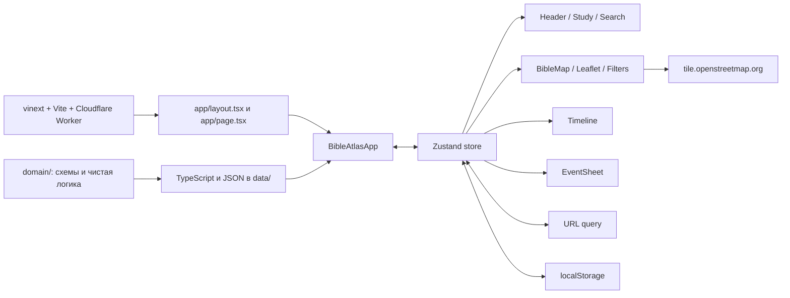

# Технический паспорт проекта «Интерактивная Библейская карта»

> Главный документ для сопровождения, переноса и восстановления проекта.  
> Актуализирован: **21 августа 2026 года**.
> Зафиксированное состояние: версия `0.1.0`, актуальное состояние ветки `main`, 168 событий, 125 мест, 23 персонажа и 20 сюжетных линий.

## 1. Назначение документа

Этот файл является главным техническим описанием проекта. Он фиксирует:

- назначение и фактические возможности приложения;
- архитектуру, потоки данных и состояние интерфейса;
- структуру каталогов и роль каждого исходного файла;
- модели библейских данных и редакционные ограничения;
- зависимости, команды, переменные окружения и внешние сервисы;
- порядок локального запуска, сборки, тестирования, публикации и полного восстановления;
- генерируемые, локальные и необязательные файлы;
- известные технические долги и результаты последней проверки.

Правило обязательной синхронизации закреплено в корневом `AGENTS.md`: любое изменение исходников, данных, конфигурации, зависимостей, тестов, структуры или поведения проекта должно сопровождаться обновлением этого документа в той же задаче.

## 2. Краткое описание продукта

«Библейская карта» — русскоязычное одностраничное веб-приложение, связывающее события Священного Писания с:

- географическими местами и современными координатами;
- временной шкалой без фиктивного нулевого года;
- персонажами;
- книгами Писания;
- сюжетными линиями и последовательностями маршрутов;
- точными ссылками и встроенным текстом Синодального перевода 1876 года;
- отдельными редакционными слоями истории, географии и церковного Предания.

Приложение работает преимущественно на клиенте. Для основного сценария не требуются аккаунты, CMS, API приложения или база данных. Библейские данные включаются в клиентскую сборку из локальных TypeScript- и JSON-файлов.

### Фактические пользовательские возможности

- интерактивная карта Leaflet с растровой подложкой OpenStreetMap;
- группировка событий по основной географической точке;
- маркеры Ветхого и Нового Заветов, интерактивные подписи мест;
- пунктирные маршруты книги, персонажа или выбранной сюжетной линии;
- отдельные отключаемые слои современных русел Тигра и Евфрата и 10 схематичных земель/областей, прямо названных в Писании; для областей можно выбрать одну, несколько или все, а значок `i` у названия открывает редакционное объяснение и источники контура;
- компактный выпадающий фильтр непосредственно на карте рядом с легендой: Завет, маршруты, реки и области переключаются без ухода с карты и применяются сразу;
- масштабирование карты до уровня `18`, возврат к домашней области и обработка ошибки тайлов;
- временная шкала с пятью уровнями масштаба, двусторонним диапазоном, перетаскиванием всей выбранной полосы и быстрым выбором эпох на мобильных устройствах;
- режимы сюжета, персонажа, места, книги и «Все точки Писания»;
- быстрый раздел «Люди Писания» для 10 персонажей, включая Исаака, Иакова (Израиля), Иосифа (сына Израиля) и апостола Петра;
- полнотекстовый локальный поиск по событиям, людям, местам, сюжетам и книгам;
- карточка события с вкладками «Писание», «История», «География» и «Предание»;
- встроенный текст всех 219 используемых отрывков Синодального перевода;
- отдельная картографическая последовательность раннего служения по Лк. 3:21–6:49: Иордан, искушение с прямо названным Иерусалимом, Галилея, Назарет, Капернаум, озеро Геннисаретское и условный маркер неизвестного места проповеди после избрания двенадцати;
- расширенные географические последовательности всех 22 представленных книг: в частности, стоянки Исхода, походы Иисуса Навина, места Судей и пророков, промежуточные переходы четырёх Евангелий и ранних глав Деяний;
- закладки и продолжение с последнего открытого события;
- автоматическое проигрывание сюжетной последовательности со скоростью `0.5×`, `1×` или `2×`;
- сохранение выбранного режима в URL;
- адаптивный интерфейс для настольных и мобильных экранов, включая portrait/landscape, вырезы экрана и нижний Home Indicator в Safari/iOS;
- трехшаговый onboarding при первом открытии;
- web app manifest для установки как standalone-приложения.

## 3. Архитектура

### 3.1. Общая схема



### 3.2. Выполнение приложения

1. `worker/index.ts` передаёт обычные запросы обработчику vinext, а `/_vinext/image` — обработчику оптимизации изображений Cloudflare.
2. `app/layout.tsx` задаёт русскую локаль, метаданные, шрифты Geist/Lora, manifest, Leaflet CSS и глобальные стили.
3. `app/page.tsx` монтирует клиентский корневой компонент `BibleAtlasApp`.
4. `BibleAtlasApp` читает URL и `localStorage`, инициализирует Zustand, отделяет события выбранной коллекции от событий внутри активного временного диапазона и раскладывает интерфейс на панель изучения, карту, шкалу и глобальные панели. После клиентской инициализации корень получает `data-app-ready="true"` для E2E-диагностики.
5. `BibleMap` динамически импортирует Leaflet только в браузере, создаёт карту, монтирует рядом с легендой выпадающий `FiltersPanel` и независимо управляет группами маркеров, маршрутов, регионов и рек.
6. `Timeline`, `StudyPanel`, `SearchOverlay`, `FiltersPanel` и `EventSheet` читают/изменяют единое состояние Zustand.
7. Изменения ключевых выборов записываются обратно в query string без перезагрузки страницы.

### 3.3. Приоритет фильтрации событий

В `BibleAtlasApp` события отбираются в следующем порядке:

1. фильтр Завета (`ALL`, `OT`, `NT`);
2. выбранная сюжетная линия;
3. иначе выбранный персонаж;
4. иначе выбранное место;
5. иначе выбранная книга;
6. после определения коллекции активный `timeRange` ограничивает её событиями, пересекающими выбранный интервал;
7. без активного временного интервала выбранная коллекция или режим «Все точки» показываются целиком;
8. в начальном режиме без коллекции показывается не более 18 событий важности `5`.

Выбор сюжета, персонажа, места или книги взаимоисключающий. Временной диапазон применяется и внутри выбранной коллекции. Выбор конкретного события открывает карточку, но не меняет коллекцию верхнего уровня.

Шкала разделяет отображаемое окно `timeWindow` и выбранный фильтрующий интервал `timeRange`. Левый и правый края интервала регулируются независимо мышью, касанием или клавиатурой; после сужения всю полосу можно перетащить внутри отображаемого окна. Кнопки сдвига перемещают окно и интервал вместе. При выборе книги, сюжетной линии, персонажа, места или режима всех точек шкала автоматически устанавливает границы по первой начальной и последней конечной датам коллекции. Для коллекции из одной календарной даты добавляется по одному соседнему библейскому году; коллекции только с `relative`/`unknown` не получают выдуманных календарных границ.

### 3.4. Карта

Фактический картографический стек — **Leaflet 1.9.4 + OpenStreetMap**, а не MapLibre.

- URL подложки: `https://tile.openstreetmap.org/{z}/{x}/{y}.png`.
- Домашняя область: юго-запад `[24, 10]`, северо-восток `[43.5, 50]`.
- Ограничение перемещения: `[12, -18]` — `[55, 72]`.
- Минимальный масштаб: `3`; максимальный масштаб интерфейса: `18`.
- Автоматические подписи мест появляются с масштаба `9`; активная подпись видна всегда.
- События в одном основном месте объединяются в один круглый маркер.
- Цвет маркера определяется Заветом; активный маркер имеет увеличенный радиус и белую обводку.
- Маршрут строится по основным местам последовательных событий, пропускает отсутствующие координаты и подряд повторяющиеся точки.
- Линия маршрута — визуальное соединение последовательности мест, а не утверждение о точной древней дороге.
- Выбор события перемещает центр карты через `panTo`, не изменяя масштаб.
- Для всех точек и маршрута используется `fitBounds` с ограниченным максимальным масштабом.
- Ошибка четырёх и более тайлов до первого успешного тайла включает панель повторной загрузки.
- Тигр и Евфрат берутся из `data/biblical-rivers.json`; геометрия основана на HydroRIVERS и описывает современные русла.
- Отключаемый слой земель и областей рисует выбранные пользователем пунктирные полигоны из набора 10 территорий: Египет, землю Ханаанскую, Месопотамию, Галилею, Самарию, Иудею, Идумею, Десятиградие, Заиорданье и Моав. Контуры уточнены по природным рубежам и историческим справочным картам; заливка `0.18`, непрозрачность обводки `0.94`, толщина `2.2 px`. В фильтрах доступны действия «Все» и «Очистить» и отдельный checkbox каждой территории.
- Кнопка «Фильтры» находится в верхней панели самой карты. На desktop она сохраняет подпись, соседнюю легенду и прежний ограниченный высотой dropdown. На mobile легенда скрыта, остаётся единственная квадратная иконка с touch-target `44×44px`, а панель через React portal монтируется непосредственно в `document.body`, вне обрезающего контейнера карты. Изменения применяются немедленно, меню закрывается кнопкой «Готово», крестиком, `Escape` или нажатием вне него.
- Каждый полигон имеет ссылку на место Писания и всплывающее предупреждение: контур является учебной схемой, поскольку Писание не задаёт координат границ, а исторические пределы менялись.
- При масштабе ниже `7` подписываются крупные области Египта, Ханаана и Месопотамии; с масштаба `7` — меньшие области Палестины и Заиорданья. Рядом с каждой подписью находится кликабельный значок `i`: он открывает основание редакционного контура, прямые ссылки, назначение и лицензию каждого источника. Подписи вынесены в отдельный Leaflet pane с `z-index: 625`, поэтому маркеры событий не перехватывают клик по `i`; текст подписи сам не блокирует клики по карте.

### 3.5. Состояние и сохранение

Единое состояние находится в `store/useBibleStore.ts`.

| Группа | Поля |
| --- | --- |
| Основной выбор | `activeEventId`, `activeStorylineId`, `activeCharacterId`, `activeLocationId`, `activeBookId`, `allPointsEnabled` |
| Временная шкала | `timeRange`, `timeWindow`, `timelineZoom`, `timelineFocused` |
| Карта | `testamentFilter`, `historicalRegionsEnabled`, `selectedHistoricalRegionIds`, `biblicalRiversEnabled`, `routesEnabled` |
| Панели | `searchOpen`, `studyOpen`, `filtersOpen`, `sheetTab` |
| Поиск | `searchQuery`, `searchMode` |
| Пользовательские данные | `bookmarkIds`, `storyPlaying`, `storySpeed` |

URL-параметры:

| Параметр | Значение |
| --- | --- |
| `event` | ID открытого события |
| `story` | ID сюжетной линии |
| `person` | ID персонажа |
| `place` | ID места |
| `book` | ID книги |
| `view=all` | режим всех точек |
| `testament=OT` / `NT` | фильтр Завета; `ALL` в URL не записывается |

Ключи `localStorage`:

| Ключ | Назначение |
| --- | --- |
| `bible-map-onboarding` | признак завершённого onboarding |
| `bible-map-bookmarks` | JSON-массив ID событий-закладок |
| `bible-map-last-event` | последнее открытое событие |

При старте приложение удаляет старые регистрации Service Worker и кэши с префиксом `biblical-map-`. Текущая версия имеет manifest, но **не имеет offline-кэша или активного Service Worker**.

`lib/analytics.ts` содержит только типизированную точку расширения; события аналитики сейчас никуда не отправляются.

### 3.6. Адаптивная геометрия и Safari

Высота основного интерфейса задаётся CSS-переменной `--app-height`: `100vh` служит резервом, а при поддержке dynamic viewport используется `100dvh`. У приложения нет жёсткой минимальной высоты, поэтому оно не обрезается в мобильной landscape-ориентации.

- `app/layout.tsx` включает `viewportFit: "cover"`.
- Header, workspace, timeline, панели, модальные слои и элементы карты учитывают `env(safe-area-inset-*)`.
- Высота мобильной ленты эпох увеличивается на нижний safe-area, поэтому Home Indicator не отнимает место у кнопок.
- При ширине до `767px` поиск и About становятся полноэкранными. У фильтра остаётся только иконка `44×44px`; панель рендерится portal-слоем поверх workspace, получает фиксированные отступы от header, краёв visual viewport и safe-area и больше не наследует `overflow: hidden` карты. Длинное содержимое имеет явные `overflow-y: scroll`, `touch-action: pan-y` и инерцию WebKit; sticky-кнопка «Готово» остаётся в пределах панели.
- На высоте до `500px` карточка события занимает весь экран; на телефонах лента эпох сохраняется, а для промежуточной ширины `768–900px` применяется прежняя компактная геометрия.
- Поле мобильного поиска имеет размер шрифта `16px`, чтобы Safari не увеличивал страницу при фокусе.
- Для полупрозрачных слоёв одновременно заданы `backdrop-filter` и `-webkit-backdrop-filter`.
- Основные мобильные управляющие элементы имеют touch-target не меньше `44px`; карта показывает только иконку фильтра, а desktop-легенда не изменена.
- Только при ширине до `767px` временной блок сокращён до ленты эпох высотой `64px` плюс нижний safe-area: заголовок диапазона, кнопки сдвига/масштаба, трек, маркеры и подписи дат скрыты. Эпохи остаются отдельной однострочной CSS Grid-лентой с несжимаемыми колонками и нативной горизонтальной прокруткой WebKit (`overflow-x: scroll`, `touch-action: pan-x`, `-webkit-overflow-scrolling: touch`). Desktop timeline сохраняет полный функционал.
- Мобильная анимация карточки события меняет только прозрачность: фиксированная карточка не смещается ниже viewport даже во время открытия. Десктопная геометрия и анимация этим правилом не затронуты.

## 4. Данные и предметная модель

### 4.1. Текущий объём

| Набор | Количество / размер |
| --- | --- |
| События | 168: 102 Ветхого Завета, 66 Нового Завета |
| События с географией | 165; без географии — 3 |
| Места | 125 |
| Персонажи | 23 |
| Персонажи в быстром разделе «Люди Писания» | 10 |
| Сюжетные линии | 20 |
| Книги, фактически связанные с событиями | 22 |
| Структурированные ссылки на Писание | 219 |
| Полный Синодальный корпус | 78 книг, около 6.16 МБ |
| Выборка используемых отрывков | 219 ключей, около 1.12 МиБ |
| Реки | 2 GeoJSON LineString: Евфрат и Тигр |
| Земли и области | 10 схематичных полигонов со ссылками на Писание |

Фактически используемые книги: Бытие, Исход, Числа, Второзаконие, Иисус Навин, Судьи, 1–4 Царств, Иона, Исаия, Иеремия, Даниил, 1 Ездры, Есфирь, Неемия, четыре Евангелия и Деяния.

Схемы поддерживают больше вариантов, чем текущий контент. Например, хронология допускает `exact`, `range` и `unknown`, но текущие 168 событий используют `relative` (6 событий) или `approximate` (162 события). Все текущие события имеют `evidenceType: scripture_explicit`.

### 4.2. `BibleEvent`

| Поле | Смысл |
| --- | --- |
| `id`, `slug` | стабильный уникальный идентификатор; сейчас совпадают |
| `titleRu`, `shortTitleRu` | русское название |
| `scriptureSummary` | нейтральный пересказ указанного текста |
| `historicalNote` | отдельно маркированная историческая справка |
| `traditionNote` | отдельно маркированное церковное Предание |
| `evidenceType` | явное Писание, вывод, Предание или реконструкция |
| `testament` | `OT` или `NT` |
| `category`, `tags` | классификация и необязательные теги |
| `importance` | целое число 1–5; влияет на начальный экран |
| `chronology` | тип, годы, русская подпись, уверенность и пояснение |
| `locations` | связанные места, их роль и порядок |
| `characters` | ID персонажей |
| `scriptureReferences` | одна или несколько структурированных ссылок |
| `storylineIds` | связанные сюжетные линии |

События редактируются как компактные `EventSeed` в `data/events.ts`. Функция `makeEvent`:

- превращает основной и параллельные отрывки в `ScriptureReference`;
- назначает умолчания важности, доказательности и хронологии;
- выбирает ровно одно основное место через `mainLocation`, аудированный словарь или последнее место;
- маркирует остальные точки как начало, конец или промежуточные точки;
- формирует сюжетные связи и категории.

### 4.3. `ScriptureReference`

Хранит Завет, ID и русское имя книги, начальную/конечную главу и стих, а также отображаемую строку (`displayRu`). Парсер `data/events.ts` понимает однословные и нумерованные сокращения Ветхого и Нового Заветов (`Быт. 1:1–2:25`, `4 Цар. 18:13–19:37`, `Мф. 28:1–10`) и правильно связывает параллельные места с соответствующей книгой. Несколько раздельных диапазонов одного события задаются отдельными `scriptureReferences`, а не строкой с точкой с запятой.

### 4.4. `BibleLocation`

Содержит древнее и современное имя, альтернативные имена, координаты, современную страну, важность и статус локализации:

- `identified` — достаточно устойчивое отождествление;
- `probable` — вероятная локализация;
- `traditional` — церковная или историческая традиция;
- `disputed` — конкурирующие гипотезы;
- `unknown` — современная координата не установлена.

Неочевидное или спорное место должно иметь `localizationNoteRu`. Эдем намеренно не имеет координат; ряд неизвестных мест может быть представлен только как широкая область с явным пояснением.

### 4.5. `BibleCharacter` и `Storyline`

Персонаж содержит ID, slug, имя, краткое описание и Завет. Сюжет содержит название, описание, Завет, вычисленный порядок событий, важность, цвет и уверенность маршрута:

- `scriptural_sequence` — последовательность мест явно следует из текста;
- `approximate` — порядок известен, точная линия пути нет;
- `disputed` — маршрут или локализации существенно спорны.

`eventIds` сюжетной линии вычисляются фильтрацией массива событий, поэтому порядок строк в `data/events.ts` является одновременно порядком повествования.

В `StudyPanel` показана курируемая выборка из 10 уже существующих персонажей: Авраам, Исаак, Иаков (Израиль), Иосиф (сын Израиля), Моисей, Давид, Пресвятая Богородица, Господь Иисус Христос, апостол Пётр и апостол Павел. Исаак, Иаков, Иосиф и Пётр связаны с существующими событиями через `BibleEvent.characters`; отдельные дубли персонажей или событий не создаются.

### 4.6. Синодальный текст

- `data/synodal-bible.json` — полный локальный корпус из 78 книг православного состава.
- `data/synodal-passages.json` — компактная выборка только используемых 219 ссылок; именно она попадает в интерфейс.
- `data/synodal.ts` — lookup по точной строке `displayRu`.
- Источник, записанный в метаданных: `https://ebible.org/find/details.php?id=russyn`.
- Перевод: Синодальный, редакция 1876 года, Public Domain.

После изменения ссылок событий необходимо выполнить `npm run bible:passages`, затем `npm test` и `npm run build`.

Полная повторная выгрузка корпуса выполняется `scripts/extract-synodal.py`, но сейчас скрипт содержит непереносимый абсолютный путь `C:\Users\MI\russyn1876-source`. Перед повторной генерацией на другой машине его нужно заменить на фактический каталог SWORD-модуля либо параметризовать. Для обычного переноса проекта регенерация не требуется: оба JSON-файла входят в Git.

### 4.7. Земли и области Писания

`data/biblical-regions.ts` содержит 10 редакционных полигонов. Для каждого обязательны уникальный ID, русское название, библейская ссылка, пояснение эпохи, цвет, координаты контура, точка подписи, отдельное объяснение выбора геометрии `sourceNoteRu` и массив `sources` с названием, ролью, URL и лицензией. Это не слой точных административных границ: геометрия служит только для пространственной ориентации и всегда сопровождается явным предупреждением о схематичности. Название территории и ссылка на Писание являются фактической частью данных; координатный контур — отдельно обозначенная учебная визуализация. Пользовательский выбор ID хранится в `selectedHistoricalRegionIds`; общий переключатель слоя не стирает выбранный набор.

Контуры сверены с тремя открытыми справочными основаниями: историческими картами У. Р. Шеперда в Perry–Castañeda Library (общественное достояние), описанием природных и исторических областей в *The Historical Geography of the Holy Land* Дж. А. Смита из Библиотеки Конгресса США (общественное достояние) и Pleiades Gazetteer (CC BY 3.0) для положения древних мест. Ни один из этих ресурсов не используется как готовая универсальная граница: итоговые вершины полигонов являются редакционным приближением, а роль каждого источника объясняется пользователю в popup.

### 4.8. Редакционная политика

Полные правила находятся в `DATA_GUIDE.md`. Критические инварианты:

- Писание, историческая реконструкция и Предание не смешиваются;
- каждое обычное событие имеет проверяемую ссылку на Писание;
- неизвестным местам не назначаются выдуманные точные координаты;
- приблизительные даты обозначаются как приблизительные;
- нулевой год запрещён;
- линия маршрута не выдаётся за установленную древнюю дорогу;
- длинные цитаты берутся из локального проверяемого корпуса, а не генерируются по памяти;
- существенное расширение данных требует редакторской и богословской вычитки.

## 5. Структура проекта

### 5.1. Сводное дерево

```text
.
├─ .openai/                 конфигурация OpenAI Sites
├─ app/                     App Router, layout, страница и глобальный CSS
├─ build/                   собственный Vite-плагин упаковки Sites
├─ components/              клиентский интерфейс и карта
├─ data/                    предметные данные и Синодальный текст
├─ db/                      отключённая заготовка Cloudflare D1/Drizzle
├─ domain/                  схемы и чистая предметная логика
├─ drizzle/                 журнал миграций; схема сейчас пустая
├─ examples/d1/             необязательный пример API заметок с D1
├─ lib/                     URL-состояние и точка аналитики
├─ public/                  manifest и SVG-иконки
├─ scripts/                 очистка production output и генерация библейских JSON
├─ store/                   Zustand store
├─ tests/                   unit, build, browser и Playwright E2E проверки
├─ worker/                  Cloudflare/vinext entry point
├─ AGENTS.md                постоянные инструкции сопровождения
├─ PROJECT_DOCUMENTATION.md этот технический паспорт
├─ README.md                вводное описание, частично устаревшее
├─ DATA_GUIDE.md            редакционные правила данных
└─ конфигурационные файлы   npm, TypeScript, Vite, Vitest, Playwright и др.
```

### 5.2. Каталог `app/`

| Файл | Роль |
| --- | --- |
| `app/layout.tsx` | Корневой HTML, язык `ru`, метаданные, viewport, manifest, шрифты и CSS. |
| `app/page.tsx` | Единственный маршрут `/`; выводит `BibleAtlasApp`. |
| `app/globals.css` | Вся визуальная система: CSS-переменные, карта, панели, timeline, dynamic viewport, safe-area, Safari/WebKit fallback, responsive breakpoints `1100`/`767`, короткий landscape `900×500`, узкий экран `350` и reduced motion. Tailwind импортирован, но основной UI описан вручную. |
| `app/chatgpt-auth.ts` | Утилиты чтения ChatGPT auth headers и безопасных sign-in/sign-out URL. В текущем маршруте не импортируется и авторизация не требуется. |

### 5.3. Каталог `components/`

| Файл | Роль |
| --- | --- |
| `BibleAtlasApp.tsx` | Композиционный корень, инициализация URL/localStorage, разделение коллекционного и временного фильтров, диагностический признак готовности, сюжетный таймер и удаление старого SW-кэша; фильтр карты больше не монтируется как глобальный overlay. |
| `BibleMap.tsx` | Leaflet, OSM-подложка, маркеры, tooltip, маршруты, реки, области, отдельный слой подписей и source-popup по значку `i`, fit/pan, диагностика готовности и верхняя панель с легендой/фильтром. |
| `Timeline.tsx` | Шкала, маркеры датированных событий, два доступных края диапазона, перетаскиваемая выбранная полоса, эпохи, сдвиг, масштаб 1–5 и автоподгонка коллекций. |
| `StudyPanel.tsx` | Навигатор по сюжетам, книгам, 10 избранным персонажам, закладкам и последнему событию; проигрыватель сюжета. |
| `EventSheet.tsx` | Карточка события, четыре вкладки, полный текст Писания, переходы, закладка и копирование URL. |
| `SearchOverlay.tsx` | Клиентский поиск без внешнего индекса; ограниченные выдачи по пяти типам сущностей. |
| `FiltersPanel.tsx` | Фильтры Завета, маршрутов, рек и земель/областей Писания; внутри слоя — выбор отдельных территорий, «Все»/«Очистить», предупреждение о схематичности и закрытие снаружи. Desktop сохраняет dropdown внутри карты; mobile определяется через `useSyncExternalStore`/`matchMedia` и рендерит тот же диалог через React portal в `document.body`, чтобы карта не обрезала вертикальную прокрутку. |
| `Header.tsx` | Бренд, навигация и поиск; мобильное меню. Фильтр из header удалён. |
| `AboutPanel.tsx` | Принципы редакционной честности и внешняя ссылка на «Азбуку веры». |

### 5.4. Каталоги `domain/`, `data/`, `store/`, `lib/`

| Файл | Роль |
| --- | --- |
| `domain/types.ts` | Zod-схемы, выведенные TypeScript-типы и русские подписи неопределённости. |
| `domain/timeline.ts` | Формат годов, переход через отсутствие нулевого года в обе стороны, сортировка, видимость, эпохи, вычисление масштаба и точных границ коллекции. |
| `domain/event-locations.ts` | Единое правило выбора основного места события. |
| `domain/map-route.ts` | Построение последовательности точек с удалением подряд идущих дублей. |
| `data/events.ts` | 168 семян событий, parser ссылок Ветхого/Нового Заветов, аудит основных мест и генерация `BibleEvent`; добавлены проверенные географические переходы во всех представленных книгах. |
| `data/locations.ts` | 125 мест, координаты и пояснения локализации; спорные стоянки Исхода, области евангельских событий и неизвестные точные места явно маркированы как `disputed`, `traditional` или `unknown`. |
| `data/biblical-regions.ts` | 10 уточнённых учебных полигонов земель и областей со ссылками на Писание, редакционным обоснованием, массивами открытых источников/лицензий, цветами, позициями подписей и предупреждением о неточности границ. |
| `data/characters.ts` | 23 персонажа; видимые подписи различают Иакова (Израиля) и Иосифа (сына Израиля). |
| `data/storylines.ts` | 20 сюжетов; состав вычисляется из событий. |
| `data/books.ts` | Производный список 22 книг и числа событий/мест. |
| `data/repository.ts` | Zod-валидация, проверка уникальности и перекрёстных ссылок, локальный async repository. В UI напрямую почти не используется. |
| `data/synodal.ts` | Типизированный доступ к выборке Синодального текста. |
| `data/synodal-bible.json` | Полный корпус 78 книг. |
| `data/synodal-passages.json` | Используемые в карточках отрывки. |
| `data/biblical-rivers.json` | GeoJSON современных русел Тигра и Евфрата. |
| `store/useBibleStore.ts` | Все состояния и действия Zustand. |
| `lib/url-types.ts` | Тип сериализуемого снимка состояния. |
| `lib/url-state.ts` | Чтение/запись query string. |
| `lib/analytics.ts` | No-op API будущей аналитики. |

### 5.5. Сборка, Worker, БД и примеры

| Файл | Роль |
| --- | --- |
| `vite.config.ts` | vinext, Cloudflare plugin, Sites plugin, локальные binding, polling в Seatbelt, удаление устаревших `sw.js` и MapLibre worker. |
| `build/sites-vite-plugin.ts` | После build копирует `.openai/hosting.json` и `drizzle/` в `dist/.openai`. |
| `worker/index.ts` | Cloudflare Worker entry point и image optimization endpoint. |
| `.openai/hosting.json` | Sites project ID; `d1` и `r2` сейчас `null`. |
| `db/index.ts` | Получение Drizzle-клиента из `env.DB`; в активном приложении не используется. |
| `db/schema.ts` | Пустая схема БД. |
| `drizzle.config.ts` | SQLite/D1-генерация миграций из `db/schema.ts`. |
| `drizzle/meta/_journal.json` | Пустой журнал миграций. |
| `examples/d1/db/schema.ts` | Пример таблицы `notes`, не часть активной схемы. |
| `examples/d1/app/api/notes/route.ts` | Пример GET/POST API заметок, не подключён к активному `app/`. |

### 5.6. Скрипты и тесты

| Файл | Роль |
| --- | --- |
| `scripts/clean-dist.mjs` | Перед production build безопасно удаляет только проверенный генерируемый каталог `dist`, чтобы старые хешированные chunks не попадали в новый Worker. |
| `scripts/build-synodal-passages.mjs` | Пересобирает выборку отрывков по ссылкам всех событий. |
| `scripts/extract-synodal.py` | Извлекает полный корпус из локального SWORD-модуля через PySword. |
| `tests/timeline.test.ts` | Хронология, данные, книги, состав коллекций и порядок выбранных событий Лк. 3–6. |
| `tests/location-audit.test.ts` | Основные места, статусы локализации, последовательность Иордан → Иерусалим → Галилея → Назарет → Капернаум → море Галилейское → неизвестное место проповеди и синхронность карта/шкала. |
| `tests/synodal.test.ts` | Метаданные, известные стихи, прямой текст Лк. 4–5 и покрытие всех ссылок. |
| `tests/rivers.test.ts` | Состав и валидность GeoJSON рек. |
| `tests/regions.test.ts` | Состав, уникальность, координатная валидность и обязательная маркировка схематичности 10 земель/областей. |
| `tests/map-route.test.ts` | Последовательные маршруты и удаление дублей. |
| `tests/map-modes.test.ts` | Переходы Zustand между режимами карты. |
| `tests/book-geography-audit.test.ts` | Регрессионный аудит всех 22 книг: обязательные географические ориентиры, порядок по тексту, наличие координат, связь параллельных мест и полный разбор диапазонов стихов. |
| `tests/e2e/atlas.spec.ts` | Playwright: Авраам с автоподгонкой сюжета и прокруткой мобильного списка событий, точный выбор Иерусалима в разделе мест, URL фильтра НЗ через dropdown, точные границы книги, клавиатурное изменение края и перетаскивание диапазона, а также мобильная геометрия. Safari-проверка контролирует скрытие легенды и полной шкалы, высоту компактной ленты эпох, её горизонтальную прокрутку, иконку фильтра `44×44px`, portal-родителя диалога, вертикальный диапазон после раскрытия списка областей, прокрутку до полностью видимой кнопки «Готово» и закрытие панели. |
| `tests/verify-map-build.mjs` | Пост-build аудит клиентского bundle: Leaflet/OSM, Писание, реки, слой областей, controls и отсутствие старого SW. |
| `tests/map-browser-check.mjs` | Расширенная проверка живой карты, zoom, tooltip, route/rivers toggles, расположения dropdown внутри карты и screenshots закрытого/открытого фильтра. Требует отдельного сервера. |
| `tests/book-mode-browser-check.mjs` | Проверка книг Марка/Луки/Матфея, синхронности карта/шкала/навигация, семи маркеров Лк. 3–6, расположения фильтра на карте, выбора только Галилеи, восстановления всех 10 областей, их подписей/предупреждений и режима всех точек. Требует отдельного сервера. |
| `tests/rendered-html.test.mjs` | Оставшийся тест starter skeleton; не входит в `npm test` и сейчас не соответствует активному приложению. |

### 5.7. Публичные и корневые файлы

| Файл | Роль |
| --- | --- |
| `public/manifest.webmanifest` | PWA-метаданные, standalone display и две иконки. |
| `public/favicon.svg`, `icon-192.svg`, `icon-512.svg` | Активные иконки карты. |
| `public/file.svg`, `globe.svg`, `window.svg` | Неиспользуемые starter-ассеты; безопасно удалить только после проверки ссылок. |
| `package.json` | Версия, Node engine, команды и прямые зависимости. |
| `package-lock.json` | Точный npm dependency graph; обязателен для воспроизводимого `npm ci`. |
| `tsconfig.json` | Strict TypeScript, alias `@/*`, noEmit; исключает DB, Worker и E2E. |
| `vitest.config.ts` | Node environment и `tests/**/*.test.ts`. |
| `playwright.config.ts` | Сервер на `3000`; WebKit-проекты iPhone 13 portrait/landscape и iPhone SE шириной 320 px, а также контрольный desktop Chromium 1440×900. |
| `eslint.config.mjs` | Next core-web-vitals и TypeScript правила. |
| `postcss.config.mjs` | Tailwind PostCSS plugin. |
| `next.config.ts` | Пустая заготовка Next-конфигурации. |
| `.env.example` | Устаревший пример MapLibre URL; активный код его не читает. |
| `.gitignore` | Исключает зависимости, outputs, env, логи, tool caches, источники корпуса и корневые PNG-снимки `*-check.png`, создаваемые browser QA. |
| `README.md` | Полезное продуктовое введение, но содержит устаревшие MapLibre/Map-style/offline утверждения. |
| `DATA_GUIDE.md` | Обязательная редакционная инструкция. |
| `Локальный запуск.cmd` | Windows: build, открытие браузера и `vinext start` на `127.0.0.1:3000`. |

## 6. Технологический стек и зависимости

### Основные зависимости

| Пакет | Версия | Назначение |
| --- | --- | --- |
| `react`, `react-dom` | `19.2.6` | UI |
| `next` | `16.2.6` | App Router API, метаданные, шрифты и типы |
| `vinext` | `0.0.50` | выполнение Next-подобного приложения через Vite/Cloudflare |
| `vite` | `8.0.13` | сборка |
| `leaflet` | `^1.9.4` | карта |
| `zustand` | `^5.0.14` | клиентское состояние |
| `zod` | `^4.4.3` | runtime-валидация данных |
| `lucide-react` | `^1.31.0` | иконки |
| `drizzle-orm` | `0.45.2` | резервная D1-интеграция |
| `@cloudflare/vite-plugin`, `wrangler` | `1.37.1`, `4.92.0` | локальная и production Cloudflare-среда |
| `vitest`, `@playwright/test` | `^4.1.10`, `^1.62.1` | unit и E2E тесты |
| `typescript` | `5.9.3` | типизация |
| `eslint` / `eslint-config-next` | `9.39.4` / `16.2.6` | статический анализ |
| `tailwindcss` | `4.2.1` | PostCSS/Tailwind import; UI в основном написан обычным CSS |

`magic-string` объявлен прямой зависимостью, но исходный код проекта его напрямую не импортирует. Testing Library и jsdom также установлены, хотя текущие unit-тесты работают в Node без React DOM rendering.

### Требования к окружению

- `package.json` требует Node.js `>=22.13.0`.
- Последняя проверка выполнена на Node `v24.11.1`, npm `11.6.2`, Windows/PowerShell.
- Для `scripts/extract-synodal.py` нужен Python и локальный PySword/SWORD-модуль; для обычной разработки Python не нужен.
- Для загрузки карт требуется доступ к `tile.openstreetmap.org`.
- Для Playwright E2E после чистой установки могут понадобиться браузеры: `npx playwright install`. Мобильные проекты явно используют WebKit, desktop — Chromium.

## 7. Команды

| Команда | Что делает |
| --- | --- |
| `npm ci` | Воспроизводимая установка строго по lockfile; предпочтительно после переноса/в CI. |
| `npm install` | Установка с возможным обновлением lockfile. |
| `npm run dev` | vinext dev server, обычно `http://localhost:3000`. |
| `npm run build` | Безопасная очистка `dist`, production build и обязательный `verify-map-build.mjs`. |
| `npm run start` | Запуск production build. |
| `npm test` | 8 Vitest-файлов, сейчас 38 тестов. |
| `npm run test:e2e` | Playwright E2E; сам поднимает dev server на `3000` и прогоняет WebKit на iPhone 13 portrait/landscape и iPhone SE 320 px, затем desktop Chromium. |
| `npm run test:map` | Browser-аудит карты; по умолчанию ожидает сервер на `127.0.0.1:3100`. |
| `npm run test:books` | Browser-аудит режимов книг; по умолчанию ожидает сервер на `127.0.0.1:3100`. |
| `npm run lint` | ESLint всего проекта, кроме `dist` и `.next`. |
| `npm run bible:passages` | Пересборка `data/synodal-passages.json`. |
| `npm run db:generate` | Генерация Drizzle migration; сейчас схема пустая. |

Для browser-check на другом адресе используются `MAP_CHECK_URL` и `BOOK_CHECK_URL`. Например, в PowerShell:

```powershell
$env:MAP_CHECK_URL = "http://127.0.0.1:3000/?story=abraham"
npm.cmd run test:map
```

## 8. Переменные окружения и внешние зависимости

### Активные/служебные переменные

- `MAP_CHECK_URL` — URL для `tests/map-browser-check.mjs`.
- `BOOK_CHECK_URL` — URL для `tests/book-mode-browser-check.mjs`.
- `CODEX_SANDBOX=seatbelt` — включает polling файлов в Vite preview на macOS Seatbelt.
- `WRANGLER_WRITE_LOGS`, `WRANGLER_LOG_PATH`, `MINIFLARE_REGISTRY_PATH` — задаются `vite.config.ts`, чтобы Wrangler хранил состояние локально.

`NEXT_PUBLIC_MAP_STYLE_URL` из `.env.example` **не используется**: это остаток прежней архитектуры MapLibre. Текущий URL OSM жёстко задан в `components/BibleMap.tsx`.

### Внешние сетевые ресурсы

- OpenStreetMap tile server — обязательная runtime-подложка карты.
- HydroRIVERS — источник геометрии рек, но сами линии уже находятся локально.
- eBible — источник локально сохранённого Синодального корпуса; runtime-запрос не нужен.
- Perry–Castañeda Library: исторический атлас У. Р. Шеперда — публичная ссылка в пояснениях областей, общественное достояние; runtime не загружает оттуда геометрию.
- Library of Congress: *The Historical Geography of the Holy Land* Дж. А. Смита — публичная ссылка в пояснениях областей, общественное достояние; runtime не загружает оттуда данные.
- Pleiades Gazetteer — публичная ссылка в пояснениях областей, CC BY 3.0; использован для сверки древних мест, а не как источник готовых полигонов.
- «Азбука веры» — только пользовательская внешняя ссылка в About.
- Google Fonts через `next/font/google` — шрифты Geist и Lora обрабатываются сборочным стеком.

При высокой публичной нагрузке необходимо выбрать tile provider или собственную инфраструктуру, соответствующую политике использования тайлов; прямой публичный `tile.openstreetmap.org` не следует считать безлимитным production backend.

## 9. Сборка и публикация

`npm run build` сначала запускает `scripts/clean-dist.mjs`, который проверяет, что целью является обычный каталог `dist` непосредственно в корне проекта и отказывается удалять символическую ссылку. Это исключает накопление старых хешированных chunks между сборками.

После очистки `vite.config.ts` создаёт цепочку плагинов:

1. удаление устаревших `dist/client/sw.js` и `maplibre-gl-worker.mjs`;
2. vinext;
3. собственная упаковка Sites;
4. Cloudflare Vite plugin с RSC/SSR окружениями.

Локальная Worker-конфигурация указывает `worker/index.ts`, включает `nodejs_compat` и создаёт D1/R2 bindings только если они названы в `.openai/hosting.json`. Сейчас оба binding равны `null`, поэтому БД и R2 не нужны.

Production-результат находится в `dist/`; `dist/.openai` получает hosting config и drizzle metadata. `dist/`, `.vinext/` и `.wrangler/` являются генерируемыми каталогами и не переносятся как исходники.

Действующий публичный адрес: `https://biblical-history-map-ru.ask285003.chatgpt.site`.

Текущая production-публикация — Sites version `26`, успешно развёрнутая 21.08.2026 из коммита `0397458adb4cd9e6a6d0c12e31ba775dbc430e82`. Она включает mobile portal-диалог фильтров с вертикальной touch-прокруткой и сокращённую до эпох мобильную timeline; desktop-компоновка сохранена.

Сборка сообщает предупреждение о клиентских chunks крупнее 500 КБ. Основная причина — карта и локальный текст Писания в клиентском bundle. Это не блокирует build, но является точкой оптимизации. Очистка `dist` перед каждой сборкой обязательна: без неё vinext сохранял прежние chunks рядом с новыми, и архив публикации мог превысить лимит Worker.

## 10. Полное восстановление после переноса

### 10.1. Что обязательно сохранить

Лучший вариант — перенести Git-репозиторий целиком или сделать clone. Если перенос выполняется простым копированием, обязательно сохранить:

- все отслеживаемые Git файлы;
- скрытый `.openai/hosting.json`;
- `package.json` и `package-lock.json`;
- каталоги `app`, `build`, `components`, `data`, `db`, `domain`, `drizzle`, `examples`, `lib`, `public`, `scripts`, `store`, `tests`, `worker`;
- корневые конфигурации, `README.md`, `DATA_GUIDE.md`, `AGENTS.md` и этот файл.

Критически важно не потерять большие, но отслеживаемые файлы `data/synodal-bible.json` и `data/synodal-passages.json`: без них карточки Писания и build verification не восстановятся.

### 10.2. Что переносить не нужно

Следующее безопасно пересоздаётся или является локальным мусором:

- `node_modules/` и `node_modules.incomplete-*`;
- `dist/`, `.vinext/`, `.wrangler/`;
- `tsconfig.tsbuildinfo`;
- `.dev-*.log`, `.prod-*.log`, `.local-*.log` и PID-файлы;
- browser screenshots (`.map-browser-check.png`, `.book-mode-check.png`, `.max-zoom-check.png` и подобные);
- `.pysword-tool/`, `.russyn1876-source/`, `.russyn-usfm-source/`, если полный корпус не планируется регенерировать.

На момент первичной инвентаризации в проекте присутствовали две копии зависимостей: обычный `node_modules` (~773 МиБ) и `node_modules.incomplete-20260812` (~602 МиБ). Обе не являются частью исходников; после успешного `npm ci` резервная incomplete-копия не нужна.

### 10.3. Пошаговое восстановление

```powershell
# 1. Перейти в корень проекта
Set-Location "C:\путь\к\Интерактивная Библейская карта"

# 2. Проверить подходящую версию Node
node --version
npm.cmd --version

# 3. Установить точные зависимости
npm.cmd ci

# 4. Проверить данные и логику
npm.cmd test

# 5. Собрать production-версию
npm.cmd run build

# 6. Запустить локально
npm.cmd run start
```

Для разработки вместо шагов 5–6 используется `npm.cmd run dev`. Переменная `.env.local` текущему приложению не требуется.

После чистой установки для E2E:

```powershell
npx.cmd playwright install
npm.cmd run test:e2e
```

### 10.4. Критерии успешного восстановления

- `/` открывается без server error;
- карта сообщает `data-map-engine="leaflet-openstreetmap"` и после загрузки тайлов `data-map-ready="true"`;
- `npm test` проходит;
- `npm run build` завершается строкой о проверенной OSM-подложке и biblical overlay bundle;
- карточка события показывает локальный Синодальный текст;
- URL сохраняет выбор сюжета/книги/места;
- отсутствуют опубликованные `sw.js` и MapLibre worker;
- карта показывает два речных слоя, выбранные маршруты и при включении выбранный пользователем набор из 10 схематичных областей с предупреждением о неточности границ; на desktop переключатели доступны из dropdown рядом с легендой, а на mobile — из единственной иконки фильтра;
- WebKit E2E на iPhone 13 portrait/landscape и iPhone SE 320 px удерживает header, карту, ленту эпох, поиск, фильтры и карточку события внутри viewport; при наличии overflow строка эпох прокручивается до последней кнопки, portal-диалог фильтров прокручивается до доступной кнопки «Готово».

## 11. Локальные и генерируемые каталоги

| Путь | Статус | Восстановление |
| --- | --- | --- |
| `.git/` | история проекта | clone или копирование Git metadata |
| `node_modules/` | генерируемый | `npm ci` |
| `node_modules.incomplete-*` | остаток неудачной/резервной установки | не нужен |
| `dist/` | production output | `npm run build` |
| `.vinext/` | build/dev cache | создаётся автоматически |
| `.wrangler/` | локальное состояние Cloudflare | создаётся автоматически |
| `.pysword-tool/` | локальная копия PySword | нужна только для полного extract |
| `.russyn1876-source/` | локальный SWORD-корпус | не нужен, пока JSON уже сохранён |
| `.russyn-usfm-source/` | локальный USFM-источник | активными скриптами не используется |
| `*.log`, `*-pid` | локальные процессы | не переносить |
| `*.png` в корне | результаты browser QA | не часть runtime |

## 12. Проверки и текущее качество

Последняя локальная проверка 21.08.2026:

| Проверка | Результат |
| --- | --- |
| `npm test` | **успешно**: 8 файлов, 38 тестов; включая структуру/источники всех 10 областей, связи четырёх добавленных в быстрый раздел персонажей и аудит географии всех 22 представленных книг |
| `npm run build` | **успешно**: безопасная очистка `dist`, 54 актуальных файла общим размером около 5.27 МиБ, vinext build + bundle verification, включая source-popup областей, нужных персонажей и расширенный локальный текст |
| `npx.cmd tsc --noEmit` | **успешно**: ошибок TypeScript нет |
| `npm run lint` | **неуспешно**: 2 прежние ошибки `react-hooks/set-state-in-effect` и 3 прежних предупреждения о неиспользуемых символах; мобильные стили, конфигурация и E2E-сценарий новых сообщений не добавили |
| Конфигурация Playwright | **успешно**: полный запуск собрал 20 тестов в четырёх проектах |
| Desktop E2E книги и сюжетной линии | **успешно**: автограницы сюжета и книги, изменение левого края и перетаскивание всего диапазона подтверждены в Chromium |
| `npm run test:e2e` | **успешно**: 16 тестов пройдено, 4 неприменимых теста пропущено; зелёные WebKit-профили iPhone 13 portrait/landscape и iPhone SE 320 px, а также контрольный desktop Chromium |
| `npm run test:books` | **успешно**: 24 события Марка и 29 событий Луки синхронны в навигации, на карте и шкале; подтверждены семь последовательных событий Лк. 3:21–6:49, выбор только Галилеи и восстановление всех 10 областей, заливка `0.18`, обводка `2.2 px`, рабочий `i` с тремя источниками, четыре новых имени в быстром разделе, 97 маркеров режима всех точек и отсутствие browser errors |
| `npm run test:books` на публичном Sites URL | **успешно для Sites version 22**: 24 события Марка, 29 событий Луки, синхронные карта/шкала/навигация, выбор только Галилеи и восстановление всех 10 областей, встроенные параллельные тексты, 97 маркеров всех точек и отсутствие browser errors |
| `npm run test:map` | **успешно**: OSM-подложка ready, 24 тайла, 9 маркеров, маршрут, 2 реки, zoom `18`, расширенный текст Писания, неизменный zoom при клике по точке, корректное расположение/открытие map-dropdown и отсутствие browser errors; визуально проверены его открытое и закрытое состояния |
| `npm run test:map` и `npm run test:books` на публичном Sites URL | **успешно для Sites version 23**: OSM-подложка ready, dropdown расположен внутри карты и отсутствует в header, route/river/region переключатели работают; 24 события Марка и 29 Луки синхронны, 97 маркеров режима всех точек, browser errors отсутствуют |
| `npm run test:map` и `npm run test:books` на публичном Sites URL после текущего изменения | **успешно для Sites version 24**: подложка ready, 10 уточнённых областей и source-popup доступны, Галилея имеет заливку `0.18` и обводку `2.2 px`, ссылки на Шеперда/Смита/Pleiades присутствуют, четыре новых имени видимы, 24 события Марка и 29 Луки синхронны, 97 маркеров всех точек, browser errors отсутствуют |
| Первая попытка публикации предыдущего изменения | **неуспешно**: хостинг отклонил Worker больше 10 МиБ; причиной оказались старые хешированные chunks от предыдущих сборок в `dist`, после чего в обязательный build-поток добавлена проверенная очистка каталога |
| Публикация текущего изменения | **успешно**: Sites version 24 сохранена из коммита `8da2ed9`, production deployment завершён, публичный адрес отвечает и прошёл полные `test:map`/`test:books` |
| Публикация мобильной Safari-адаптации | **успешно**: Sites version 25 сохранена из коммита `20ee60d`, production deployment `appgdep_6a8860253a30819182884cb95c871297` завершён со статусом `succeeded`, а Sites сообщает version 25 текущей для публичного адреса; прямой автоматизированный post-deploy запрос из локального окружения получил Cloudflare `403`, поэтому подтверждение интерфейса основано на зелёной локальной WebKit-матрице и статусе Sites, а не на обходе защиты публичного домена |
| Публикация мобильного portal-фильтра и ленты эпох | **успешно**: Sites version 26 сохранена из коммита `0397458` с 54 файлами production-архива и развёрнута deployment `appgdep_6a88674559688191a424609544889c75`; Sites вернул статус `succeeded` и прежний публичный URL |

Первый запуск `npm test` в этой задаче выявил не ошибку данных, а слишком буквальное ожидание теста: корпус 1876 года содержит в Лк. 5:11 написание «оставили все», тогда как проверка ожидала «оставили всё». Ожидание исправлено по фактическому локальному Синодальному тексту; повторный запуск полностью успешен.

Первый запуск production browser-check был передан с `?book=luke`, хотя сам сценарий по устройству начинает проверку с книги Марка, и поэтому остановился на ожидании заголовка «От Марка». Повторный запуск с предусмотренной стартовой книгой `?book=mark` перешёл внутри сценария к Луке и завершился полностью успешно; это была ошибка параметра запуска проверки, а не интерфейса или данных.

В текущей задаче первая команда обязательных проверок через `npm` была заблокирована системной политикой PowerShell для `npm.ps1`; те же команды выполнены через штатный `npm.cmd` и прошли. Первый browser-check обнаружил, что маркер события над Галилеей перехватывал клик по значку источника: подписи областей вынесены в отдельный верхний Leaflet pane, а кликабельность ограничена самим `i`; повторный `test:books` и `test:map` прошли без browser errors. Встроенная браузерная поверхность не предоставила доступного экземпляра, поэтому UI проверен локальным Chrome/Playwright и визуальным просмотром `.regions-source-check.png`/`.regions-layer-check.png`.

В текущей задаче первый `npm test` после расширения данных обнаружил две основные точки одного события `elisha-shunem`: повторный Сонам в маршруте становился второй основной точкой из-за модели, связывающей роль с ID места. Последовательность сведена к Кармил → Сонам с одной основной точкой; повторный запуск полностью успешен. После финальной редакционной проверки удалена предложенная точка Дан. 6 в Вавилоне: город львиного рва текстом главы не назван. Первый browser-check после этой пересборки получил старый asset manifest от ещё работавшего локального production-процесса и завершился `ENOENT`; после штатного перезапуска сервера на новой сборке сценарий полностью прошёл. Встроенная браузерная поверхность Codex в сессии снова не предоставила ни одного доступного браузера; после обязательной проверки подключения визуальная QA выполнена локальным Chrome/Playwright. Browser-check проверил не только общий переключатель, но и выбор единственной Галилеи и последующее восстановление всех областей.

Первая команда упаковки Sites получила Windows-путь вида `C:/...`, который GNU tar в Git Bash ошибочно интерпретировал как удалённый адрес. Повтор с POSIX-представлением `/c/...` успешно создал проверенный архив; это проблема формы аргумента локального инструмента, а не сборки проекта.

Повторная проверка мобильного Safari воспроизвела показанную пользователем проблему: при viewport 390 px строка эпох сама расширялась примерно до 606 px, поэтому у неё не оставалось внутреннего диапазона прокрутки. Исправление ограничено медиавыражением `max-width: 767px`: ширина mobile map/timeline зафиксирована в пределах viewport, строка эпох получила отдельную горизонтальную touch-прокрутку, а анимация карточки больше не выносит её нижнюю границу за экран. По дополнительным скриншотам лента усилена явной однострочной Grid-геометрией, мобильный trigger фильтра сведён к иконке `44×44px`, а dropdown заменён на фиксированную в visual viewport панель с внутренней прокруткой и sticky-кнопкой завершения. Первичный WebKit-прогон также выявил устаревшие шаги E2E для мобильного списка Авраама и поиска Иерусалима; сценарии синхронизированы с текущим интерфейсом. Два промежуточных целевых прогона остановились на тестовой инфраструктуре: сначала после смены CSS проверка ожидала `scroll`, получая `auto`, затем `mouse.wheel` оказался не поддержан мобильным WebKit; режим сделан явным, а проверка диапазона переведена на поддерживаемый `scrollBy`. Итоговый полный E2E зелёный на трёх мобильных WebKit-профилях и desktop Chromium. Встроенный браузер Codex не предоставил доступного экземпляра, поэтому движковая и визуальная проверка выполнена установленным Playwright WebKit. После повторного пользовательского сигнала установлено, что публичный Sites оставался на version 24; проверенный commit опубликован как version 25. Production deployment завершён успешно, но Cloudflare отклоняет автоматизированный post-deploy запрос из локального QA окружения кодом `403`.

Дополнительный снимок version 25 показал, что `position: fixed` не устранил обрезание диалога: панель всё ещё находилась внутри DOM-ветки `.map-stage`, которая образует обрезающий контекст карты, поэтому её нижняя часть и «Готово» были недоступны для touch-прокрутки. Mobile-диалог вынесен React portal-ом в `document.body`, а обработчик клика снаружи теперь учитывает portal-ref. На телефонах скрыты условные обозначения карты и все части timeline, кроме эпох; высота нижнего блока уменьшена до `64px` плюс safe-area. Первый целевой WebKit-прогон после изменения прошёл в portrait/SE, но landscape ожидал обязательный overflow при полностью поместившихся эпохах; проверка уточнена, повторный целевой прогон `3 passed`, полный E2E — `16 passed / 4 skipped` с зелёным desktop-контролем. Проверенный commit опубликован как Sites version 26; production deployment завершён со статусом `succeeded`.

Текущие lint-проблемы:

- `components/BibleAtlasApp.tsx`: синхронные `setOnboarding`/`setReady` внутри effect подпадают под `react-hooks/set-state-in-effect`;
- `components/StudyPanel.tsx`: `setLastEventId` внутри effect подпадает под то же правило;
- `components/EventSheet.tsx`: импорт `track` не используется;
- `lib/analytics.ts`: параметры no-op функции отмечаются как неиспользуемые.

## 13. Известные несоответствия и технический долг

1. `README.md` описывает MapLibre и внешний style URL, но активная карта реализована на Leaflet/OSM.
2. `.env.example` содержит неиспользуемый `NEXT_PUBLIC_MAP_STYLE_URL`.
3. README говорит о minimal offline/PWA, но текущий код удаляет старый Service Worker и offline-кэш; остаётся только manifest.
4. `tests/rendered-html.test.mjs` относится к starter skeleton, упоминает отсутствующий `app/_sites-preview` и `react-loading-skeleton` и не подключён к npm scripts.
5. `app/chatgpt-auth.ts`, Drizzle/D1 и `examples/d1` — подготовленные, но неактивные части архитектуры.
6. `scripts/extract-synodal.py` зависит от абсолютного пути вне проекта.
7. Прямой публичный OSM tile endpoint требует отдельного production-решения при росте нагрузки.
8. Клиентский bundle крупный из-за Leaflet и встроенных библейских текстов; build выдаёт warning >500 КБ.
9. Browser QA создаёт PNG в корне; шаблон `/*-check.png` внесён в `.gitignore`, сами снимки являются локальными и регенерируемыми.
10. `npm run lint` пока не является зелёной проверкой.
11. Контуры земель остаются редакционными схемами нескольких эпох, а не воспроизведением одной синхронной политической карты; Десятиградие и Заиорданье особенно нельзя понимать как неизменные административные границы.

## 14. Обязательный порядок изменения проекта

При любой задаче сопровождения:

1. прочитать `AGENTS.md`, этот документ и при работе с контентом `DATA_GUIDE.md`;
2. определить, какие разделы технического паспорта затрагивает изменение;
3. внести минимальные изменения в исходники/данные;
4. обновить соответствующие таблицы, команды, числа, схемы, дерево, ограничения и дату этого документа;
5. добавить строку в журнал изменений ниже;
6. выполнить проверки, соразмерные изменению;
7. обновить раздел «Проверки и текущее качество», если результат или набор проверок изменился;
8. не считать задачу завершённой, пока документация не синхронизирована.

## 15. Журнал изменений документации

| Дата | Изменение |
| --- | --- |
| 2026-08-21 | Мобильный фильтр вынесен из обрезающей области карты в portal-слой `document.body` с вертикальной touch-прокруткой и доступной кнопкой «Готово»; на карте оставлена одна иконка фильтра, а временной блок сокращён до горизонтальной ленты эпох без диапазона, controls, трека и дат. Desktop UI не изменён; WebKit и полный E2E зелёные, исправление опубликовано как Sites version 26. |
| 2026-08-21 | По трём дополнительным скриншотам усилена мобильная Safari-адаптация: эпохи переведены в явный горизонтальный Grid-scroller, фильтр сокращён до квадратной иконки `44×44px`, а его окно фиксируется внутри visual viewport и прокручивается независимо; расширены WebKit-проверки геометрии и длинного содержимого, полный E2E завершён результатом 16 passed / 4 skipped без изменений desktop CSS; исправление опубликовано как Sites version 25. |
| 2026-08-21 | Повторно проверен мобильный Safari: исправлена отсутствовавшая горизонтальная touch-прокрутка эпох без изменения desktop CSS, устранён выход карточки события за viewport во время анимации, добавлен WebKit-профиль iPhone SE 320 px и усилены E2E-проверки; полный прогон завершён результатом 16 passed / 4 skipped, публикация не выполнялась. |
| 2026-08-21 | Уточнены 10 редакционных контуров областей, усилены заливка и обводка, добавлены кликабельные значки `i` с объяснением, открытыми источниками и лицензиями; устранено перекрытие `i` маркерами событий; в быстрый раздел «Люди Писания» добавлены Исаак, Иаков (Израиль), Иосиф (сын Израиля) и апостол Пётр; обновлены unit/build/browser-проверки, Sites version 24 опубликована и проверена на публичном URL. |
| 2026-08-21 | Фильтр перенесён из header непосредственно в верхнюю панель карты рядом с легендой и преобразован из полноэкранного overlay в компактный прокручиваемый dropdown с немедленным применением Завета, маршрутов, рек и выбранных областей; обновлены desktop/mobile стили, доступное управление и browser/E2E-сценарии; Sites version 23 опубликована и прошла полные публичные `test:map`/`test:books`. |
| 2026-08-21 | В фильтр областей добавлен выбор одной, нескольких или всех 10 земель; выполнен регрессионный аудит географических ориентиров всех 22 книг, добавлено 48 подтверждённых событий и 43 места, исправлен разбор диапазонов Ветхого Завета и обновлена локальная выборка до 219 Синодальных отрывков; событие Дан. 6 не нанесено в Вавилоне, поскольку город прямо не назван; unit/build/browser-проверки синхронизированы, Sites version 22 опубликована и проверена на публичном URL. |
| 2026-08-21 | Добавлено отдельное событие Лк. 6:12–49 с локальным Синодальным текстом и честно условным маркером неизвестного места; учебные круги заменены отключаемым слоем 10 пунктирных полигонов земель/областей со ссылками на Писание, масштабируемыми подписями и предупреждением о схематичности; обновлены объёмы данных и unit/build/browser-проверки, Sites version 20 опубликована и проверена на публичном URL. |
| 2026-08-21 | Добавлены и проверены отдельные события Лк. 4:1–30 и Лк. 5:1–11, точки Иерусалима, Галилеи, Назарета, Капернаума и озера Геннисаретского, осторожная география неизвестной пустыни, 158 локальных Синодальных отрывков и browser/unit-проверки последовательности книги Луки; production build дополнен безопасной очисткой `dist`, исключающей накопление старых chunks перед публикацией. |
| 2026-08-19 | Временная шкала переведена с одной активной даты на двусторонний `timeRange`: добавлены независимые края, перетаскивание полосы, фильтрация выбранных коллекций, точная автоподгонка книги/сюжета, доступное управление, тесты и актуальные результаты проверок. |
| 2026-08-18 | Синхронизированы мобильная/Safari-геометрия, safe-area и dynamic viewport, WebKit E2E для portrait/landscape и актуальные результаты проверок. |
| 2026-08-18 | Создан полный технический паспорт: архитектура, данные, файлы, зависимости, восстановление, проверки и известные расхождения. |
